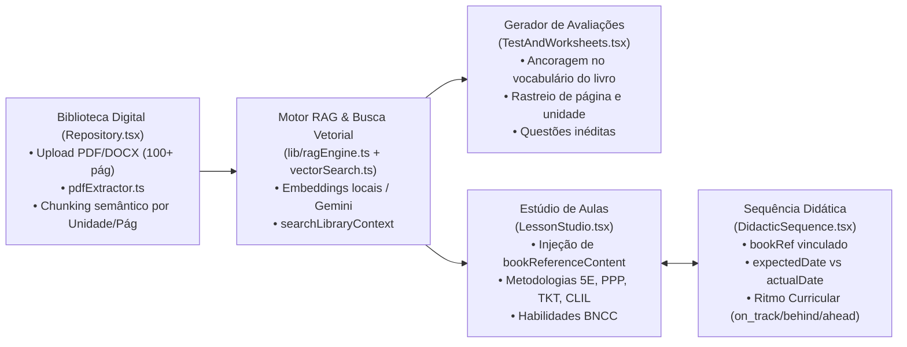

# Relatório Oficial: Auditoria Completa do App Teacher AI (Propósito, Estado Real e Posição frente ao Mercado)

**Data da Auditoria:** 09/10/2026  
**Worktree / Repositório Auditado:** `C:/Users/rafae/Documents/antigravity/hopeful-bell-engine` (e worktree base `hopeful-bell`)  
**Branch de Auditoria:** `audit/app-completa` (criada a partir de `fix/engine-provas` @ `956e9ee`)  
**Modo de Auditoria:** Somente Leitura (zero alterações de código de produto, testes ou configurações).  

---

## 1. Resumo Executivo (15 Linhas Máximo)

1. **Veredito:** Hoje, este app **não é o melhor assistente de professor do mercado, mas possui potencial real, singular e de altíssimo valor no nicho de ancoragem em livros didáticos próprios (RAG), sequências didáticas com ritmo curricular e automação de portais escolares brasileiros**.
2. **5 Maiores Riscos:**
   - **Vazamento e Insegurança de Chaves BYOK [Crítico]:** Chaves de API (OpenAI, Claude, Gemini, Groq) são gravadas em texto puro no `localStorage` (`lib/autoApiSelector.ts:153`) e trafegam via Query Parameter na URL da API Gemini (`lib/autoApiSelector.ts:245: ?key=${key}`), falhando o teste de segurança `__tests__/lote2AcceptanceTests.test.ts:237`.
   - **18 Vulnerabilidades no `npm audit` (3 Críticas):** RCE no Next.js (`GHSA-p293-qw3h-jr36`), RCE no Tinypool (`GHSA-5gmw-xhrv-c9v3`) e XSS no DOMPurify (`GHSA-55q2-fjhq-7xh7`).
   - **Risco de Perda Silenciosa de Dados por QuotaExceededError:** `lib/localDB.ts:45-49` descarta silenciosamente gravações que excedem a cota do `localStorage` (típico limite de 5MB).
   - **Injeção de Prompt no Sidecar (18 testes falhando no Pytest):** O Sidecar falhou em 18 testes, incluindo defesas contra injeção de prompt e decoupling de origem (`test_structural_prompt_injection_defense.py:322`).
   - **Quebra de Compilação TypeScript:** `npx tsc --noEmit` falha com `TS2339` em `TestAndWorksheets.tsx:496` (`description` inexistente em `HaladynaViolation`).
3. **5 Maiores Lacunas:**
   - **Desconexão OMR → OmniCorretor:** `components/modules/ExamBuilder.tsx` (1452 linhas) é 100% órfão; `ExamResultThreeTabs.tsx` gera cartão com fiduciais mas nunca salva o gabarito nem notifica o `OmniGrader.tsx`, que por sua vez não usa `lib/omr/omrEngine.ts` e tenta fazer OCR genérico por texto.
   - **Geração de Provas Desconectada de Schemas Estruturados:** `lib/examSchema.ts` (schema canônico Zod) não é importado por nenhum gerador; a prova é gerada pedindo "HTML limpo" com parsing frágil por regex.
   - **Truncamento no Banco de Questões:** Ao salvar a prova no Banco de Questões (`TestAndWorksheets.tsx:70`), salva apenas um item com `html.slice(0, 300) + '...'` em vez das questões individuais.
   - **Barreira Técnica Intransponível para o Professor no Sidecar:** Exige abrir o Chrome pelo terminal com `--remote-debugging-port=9222`, rodar Python/venv local e aceitar banner de depuração no navegador.
   - **Ausência de Integração de Ecossistema Padrão:** Não exporta para Google Classroom, Google Docs/Slides nem Microsoft Forms, recurso padrão de Brisk, MagicSchool e Diffit.

---

## 2. Achados de Segurança Críticos

### 🚨 ACHADO CRÍTICO SEC-01: Exposição de Chave de API Google Gemini via Query Parameter de URL
- **Severidade:** **ALTA / CRÍTICA**
- **Status:** `[VERIFICADO]`
- **Localização:** `lib/autoApiSelector.ts:245`
  ```typescript
  const r = await guardEgressFetch(`https://generativelanguage.googleapis.com/v1beta/models/${m}:generateContent?key=${key}`, {
    method: 'POST',
    headers: { 'Content-Type': 'application/json' },
    body: JSON.stringify({ contents: [{ parts: [{ text: prompt }] }] }),
  })
  ```
- **Evidência Crua:** Execução do teste de aceite em `__tests__/lote2AcceptanceTests.test.ts:237`:
  ```text
  FAIL __tests__/lote2AcceptanceTests.test.ts > LOTE 2 — Testes de Aceite do Engine de Provas > T4 Segurança: Chave de API não deve trafegar em query parameter de URL nem em localStorage plano
  AssertionError: expected true to be false
  - Expected: false
  + Received: true
  [T4 Security Audit] Chave exposta em query param de URL em lib/autoApiSelector.ts: true
  ```
- **Impacto:** A chave de API do Gemini trafega na URL da requisição. Fica gravada em logs de proxy corporativo, histórico de roteadores, ferramentas de telemetria de rede e cabeçalhos de referência. A Google recomenda explicitamente o envio pelo header `x-goog-api-key`.

### 🚨 ACHADO CRÍTICO SEC-02: Armazenamento de Chaves de API em Texto Puro no `localStorage`
- **Severidade:** **ALTA**
- **Status:** `[VERIFICADO]`
- **Localização:** `lib/autoApiSelector.ts:153`
  ```typescript
  const raw = localStorage.getItem('teacher_apis')
  ```
- **Impacto:** Todas as credenciais de provedores comerciais (OpenAI, Anthropic Claude, Google Gemini, Groq, DeepSeek) ficam salvas em texto não criptografado sob a chave `teacher_apis`. Qualquer vulnerabilidade XSS no app ou extensão de navegador maliciosa instalada no cliente pode ler e exfiltrar essas chaves instantaneamente.

### 🚨 ACHADO CRÍTICO SEC-03: Chamadas Client-Side para Anthropic Claude com Bypass de Segurança
- **Severidade:** **MÉDIA / ALTA**
- **Status:** `[VERIFICADO]`
- **Localização:** `lib/autoApiSelector.ts:207`
  ```typescript
  headers: { 'Content-Type': 'application/json', 'x-api-key': key, 'anthropic-version': '2023-06-01', 'anthropic-dangerously-allow-browser': 'true' }
  ```
- **Impacto:** O header `'anthropic-dangerously-allow-browser': 'true'` foi explicitamente desenhado pela Anthropic para prototipação e desaconselhado em produção, pois realiza a chamada do navegador do cliente e expõe a chave nos cabeçalhos da aba.

### 🚨 ACHADO CRÍTICO SEC-04: Vulnerabilidades de RCE e XSS em Dependências (`npm audit`)
- **Severidade:** **ALTA / CRÍTICA (18 vulnerabilidades: 3 críticas, 11 altas, 4 moderadas)**
- **Status:** `[VERIFICADO]`
- **Evidência Crua:** Saída literal de `npm audit`:
  ```text
  next 9.3.4-canary.0 - 16.3.7: Unauthenticated Remote Code Execution on windows-hosted servers - GHSA-p293-qw3h-jr36
  tinypool <=2.1.1: Prototype Pollution gadget in worker options leads to Remote Code Execution - GHSA-5gmw-xhrv-c9v3
  dompurify <=3.4.15: DOMPurify: IN_PLACE hook removal leaves a detached subtree executable, causing XSS - GHSA-55q2-fjhq-7xh7
  ```

---

## 3. Fase 1: Propósito, Módulos e Perguntas Abertas

### 3.1 O que o App é e para quem foi feito (com fontes)

1. **Público-Alvo e Problema:**
   - **Fonte:** `docs/TEACHER_AI_MASTER_AGENT_SPEC.md:11-16`, `docs/CHANGELOG_LESSON_STUDIO.md`, `lib/didacticSequenceService.ts:1-6` e `docs/ARQUITETURA_TEACHER_AI_BROWSER_HARNESS.md:10-18`.
   - **Público Declarado:** Professores do ensino básico (Fundamental II e Médio) das redes pública e privada brasileira, e professores de aulas particulares (com suporte bilíngue ELT / Cambridge e disciplinas gerais alinhadas à BNCC).
   - **Problema que resolve:** A sobrecarga burocrática massiva de planejamento de aulas, criação de avaliações alinhadas ao livro adotado pela escola, gestão do ritmo curricular bimestral e preenchimento manual repetitivo em sistemas de gestão escolar lentos e fragmentados (ex.: Machado Sobrinho, i-Educar, iDiário, SED, Plurall).
2. **Promessa Central (em 1 frase):**
   > *"Um sistema operacional pedagógico local-first com assistente de voz e automação agêntica, que extrai livros didáticos reais via RAG para criar planos de aula e avaliações contextualizadas, monitora o ritmo da sequência didática e preenche diários e notas em portais escolares sem expor dados de alunos nem exigir digitação manual repetitiva."* `[VERIFICADO]`
3. **Trabalhos do Professor que diz cobrir:**
   - **Extrair e ancorar em livros didáticos próprios:** Módulo `Repository` com `pdfExtractor.ts` e `ragEngine.ts` (chunking de 100+ páginas com busca vetorial).
   - **Gerenciar Sequências Didáticas e Ritmo Curricular:** Módulo `DidacticSequence` e `didacticSequenceService.ts` com cálculo de desvio de ritmo (`on_track`, `behind`, `ahead`).
   - **Planejar aulas com metodologias ativas:** Módulo `LessonStudio` (6491 linhas) alinhado a Cambridge TKT, 5E, PPP, Active Learning, CLIL e BNCC.
   - **Criar avaliações e listas com rigor:** Módulos `TestAndWorksheets` e `QuestionBank` com Haladyna, Bloom, CEFR, BNCC e proveniência direta da página do livro didático.
   - **Corrigir provas:** Módulo `OmniGrader` com pretensão de OMR fiducial e OCR manuscrito.
   - **Lançar notas e faltas:** Extensão Chrome + Sidecar Desktop via CDP nos portais escolares oficiais.
   - **Comunicar com famílias:** Módulos `Communications` e `ParentCommunicator` (mensagens formatadas para WhatsApp).
   - **Acompanhar evolução e diagnóstico:** Módulos `Gradebook`, `Analytics`, `Students`, `Classes`.
   - **Adaptação para NEE:** Seletores de UDL, adaptações para TDAH, Dislexia e perfis de inclusão em `TestAndWorksheets.tsx:432` e `lib/pdiManagement.ts`.
4. **Modelo de Uso:**
   - **Híbrido Web Local-First + Extensão + Worker Desktop:**
     - Web App Next.js rodando localmente (ou hospedado), guardando dados no `localStorage` do professor (BYOK).
     - Extensão Chrome MV3 (`teacher-extension/`) para conectar às abas ativas do portal.
     - Sidecar Python (`sidecar/`) rodando localmente para automações agênticas avançadas com Chrome DevTools Protocol (CDP).

### 3.2 O Coração Pedagógico do App: A Tríade Livros (RAG) + Sequência Didática + Lesson Studio

O aplicativo possui uma arquitetura pedagógica integrada que conecta três pilares essenciais:



#### A. Extração de Livros Didáticos & Biblioteca Digital (RAG)
- **Componente:** `components/modules/Repository.tsx` (3909 linhas)
- **Extração de Arquivos:** `lib/pdfExtractor.ts` (372 linhas)
  - Extrai PDFs completos (100 a 500+ páginas) via `pdfjs-dist` com ordenação de colunas e limpeza de quebras de parágrafo (`normalizeAndReconstructText`).
  - Suporta arquivos `.pdf`, `.docx`, `.txt`, `.md`, `.json`, `.csv`.
  - Exibe feedback em tempo real para o professor durante a extração (`(current, total)` páginas).
- **Indexação Semântica e Vetorial:** `lib/ragEngine.ts` (441 linhas) e `lib/vectorSearch.ts`
  - Fracionamento semântico (`indexDocumentContent`) baseado em cabeçalhos de unidades e marcadores de página (`--- Página X de Y ---`, `[UNIT X]`, `Capítulo X`).
  - Cada chunk armazena metadados granulares: `docId`, `docTitle`, `pageNumber`, `unitTitle`, `grammarFocus`, `vocabFocus`, `classGroupId`, `gradeYear`.
  - Mecanismo de busca híbrida (`searchLibraryContext` e `searchLibraryContextVector`) com embeddings rápidos ou via Gemini.
- **Ponte de Injeção no Gerador de Provas (`TestAndWorksheets.tsx:339-357`):**
  - Quando o professor cria uma avaliação sem digitar referência manual, o app consulta o livro ativo via RAG:
    ```typescript
    const chunks = searchLibraryContext(queryTopic, { limit: 8 })
    libContext = buildRagPromptContext(chunks)
    activeProvenance = { type: 'uploaded_source', sourceLabel: topChunk.docTitle, pageNumber: topChunk.pageNumber, unitTitle: topChunk.unitTitle, chunkId: topChunk.id }
    ```
  - Injeta a diretiva no prompt: `"REGRA FUNDAMENTAL: Use o material acima estritamente como BASE DE CONTEÚDO E VOCABULÁRIO. Crie QUESTÕES 100% INÉDITAS E NOVAS."`

#### B. Sequência Didática & Ritmo Curricular
- **Componente:** `components/modules/DidacticSequence.tsx` (2107 linhas)
- **Serviço de Negócio:** `lib/didacticSequenceService.ts` (361 linhas)
- **Estrutura de Unidade Didática:**
  - `DidacticSequenceDocument`: gerencia títulos de unidades (ex.: *"Unit 4: Narratives & Unfinished Actions"*), escola vinculada, turma, trimestre e **vínculo explícito com o livro didático** (`bookRef`, ex.: *"Evolve 3 Students Book (pág. 46 a 58)"*).
  - Slots de Aulas (`SequenceLessonSlot`): ordenação sequencial (Aula 1, Aula 2, ...), data prevista (`expectedDate`), data real de execução (`actualDate`), status (`planned`, `completed`, `delayed`, `pending`), tópicos e vínculo direto com plano de aula (`lessonPlanId`) e avaliações (`assessmentId`).
- **Cálculo de Ritmo Curricular (`calculateCurricularPace`):**
  - Compara o progresso realizado com a data atual e o calendário letivo, classificando a turma em:
    - `on_track` (no ritmo planejado)
    - `behind` (com atraso pedagógico, indicando quantas aulas faltam para recuperar)
    - `ahead` (adiantada)
  - Exibe badges visuais coloridos e alertas acionáveis no cabeçalho do módulo.

#### C. Estúdio de Planos de Aula (LessonStudio)
- **Componente:** `components/modules/LessonStudio.tsx` (6491 linhas)
- **Frameworks e Metodologias Pedagógicas (`lib/lessonFrameworks.ts`):**
  - **Cambridge TKT / PPP:** Presentation, Practice, Production.
  - **5E Instructional Model:** Engage, Explore, Explain, Elaborate, Evaluate.
  - **Active Learning & Peer Instruction:** Rotação por estações, sala de aula invertida.
  - **CLIL (Content and Language Integrated Learning):** Ensino integrado de linguagem e conteúdo (ciências, geografia ou história em inglês).
  - **Thinking Routines:** Rotinas de pensamento visível (Project Zero / Harvard).
  - **Spaced Retrieval Hooks:** Ganchos de recuperação espaçada para retenção de memória de longo prazo.
- **Integração Real com o Livro via RAG (`LessonStudio.tsx:1038-1054`):**
  - Se o professor seleciona o livro didático adotado (`bookTitle`), o LessonStudio consulta os chunks indexados:
    ```typescript
    const matchedChunks = searchLibraryContext(topic || description || unitChapter || bookTitle, {
      textbook: bookTitle, limit: 6, classGroupId: selectedClassId, gradeYear: currentClass?.gradeYear
    })
    bookReferenceContent = buildRagPromptContext(matchedChunks, 2000)
    ```
  - O conteúdo é inserido na diretiva do prompt (`bookReferenceContent`), fazendo com que o plano gerado faça referência exata às atividades, diálogos e exercícios das páginas do livro daquela turma.
- **Alinhamento com a BNCC (`LessonStudio.tsx:1034`):**
  - Cruza o tema com os códigos de habilidade da BNCC (ex.: `EF08LI19`), inserindo `"targetBnccCode"` em cada etapa do plano.

---

### 3.3 Mapa Geral de Módulos: Rota → Componente → Lib → Persistência

| Rota / Key | Componente UI Principal | Bibliotecas Principais | Persistência (Local/Nuvem) | Status de Ligação |
| :--- | :--- | :--- | :--- | :---: |
| `/` (`dashboard`) | `components/modules/Dashboard.tsx` | `lib/localDB.ts`, `lib/classUtils.ts` | `localStorage: teacher_dashboard_*` | **LIGADO** |
| `repo` | `components/modules/Repository.tsx` | `lib/pdfExtractor.ts`, `lib/ragEngine.ts` | `localStorage: teacher_repo_materials` + Supabase Storage | **LIGADO** |
| `didacticsequence` | `components/modules/DidacticSequence.tsx`| `lib/didacticSequenceService.ts`, `lib/ragEngine.ts` | `localStorage: teacher_didactic_sequence_units_v3` | **LIGADO** |
| `lessonstudio` / `plan` | `components/modules/LessonStudio.tsx` | `lib/lessonFrameworks.ts`, `lib/ragEngine.ts`, `lib/bnccStore.ts` | `localStorage: teacher_lesson_plans` | **LIGADO** |
| *N/A (órfão)* | `components/modules/LessonPlanner.tsx` | `lib/localDB.ts` | `teacher_lessonplanner_boards` | **PARCIAL** (importado mas não mapeado em `MODULES`) |
| `test_and_worksheets` / `exam` / `quick` | `components/modules/TestAndWorksheets.tsx` + `ExamResultThreeTabs.tsx` | `lib/autoApiSelector.ts`, `lib/haladynaLinter.ts`, `lib/ragEngine.ts` | `localStorage: teacher_saved_exams`, `teacher_exam_drafts` | **LIGADO** (com falhas de integração) |
| *N/A (órfão)* | `components/modules/ExamBuilder.tsx` | `lib/localDB.ts` | `teacher_omr_active_layout` | **ÓRFÃO (0 refs)** |
| `qbank` | `components/modules/QuestionBank.tsx` | `lib/questionBankService.ts`, `lib/psychometricsEngine.ts` | `localStorage: teacher_qbank_questions` + seed | **LIGADO** |
| `omnigrader` / `batchgrader` | `components/modules/OmniGrader.tsx` | `lib/ocrCapture.ts`, `lib/localDB.ts` | `localStorage: teacher_batch_submissions` | **PARCIAL** (usa OCR genérico, não usa `lib/omrEngine.ts`) |
| *N/A (órfão)* | `components/modules/BatchGrader.tsx` | `lib/localDB.ts` | `teacher_batch_submissions` | **ÓRFÃO** (`page.tsx:144` delega para `OmniGrader`) |
| `gradebook` | `components/modules/Gradebook.tsx` | `lib/localDB.ts`, `lib/classUtils.ts` | `localStorage: teacher_gbConfig`, `teacher_students` | **LIGADO** |
| `students` | `components/modules/Students.tsx` | `lib/studentRecord.ts`, `lib/studentMemory.ts` | `localStorage: teacher_students` | **LIGADO** |
| `classes` | `components/modules/Classes.tsx` | `lib/classService.ts`, `lib/classUtils.ts` | `localStorage: teacher_classes` | **LIGADO** |
| `analytics` / `progresstracker` | `components/modules/Analytics.tsx` | `lib/predictiveAnalytics.ts`, `lib/analyticsData.ts`| `localStorage: teacher_pedagogic_metrics` | **LIGADO** (`ProgressTracker.tsx` é órfão) |
| `bncc` | `components/modules/BnccModule.tsx` | `lib/bnccData.ts`, `lib/bnccInference.ts` | Em memória / `localStorage` | **LIGADO** |
| `privatetutoring` | `components/modules/PrivateTutoring.tsx` | `lib/localDB.ts` | `localStorage: teacher_private_students` | **LIGADO** |
| `skills` | `components/modules/PortalSkillsModule.tsx` | `lib/skills/recipeEngine.ts`, `lib/skills/graphExecutor.ts` | `localStorage: teacher_skills_*` | **LIGADO** |
| `extensions` | `components/modules/ConnectionsHub.tsx` | `lib/extensionSyncBus.ts`, `lib/portalConnectionService.ts` | `localStorage: teacher_connected_portals` | **LIGADO** (`Extensions.tsx` órfão) |
| `audiopronunciation` | `components/modules/AudioPronunciation.tsx`| `lib/audioFeedback.ts`, `lib/audioRecorder.ts` | Memória / Web Audio API | **LIGADO** (foco exclusivo em Inglês/ELT) |
| `meetingclassrecorder`| `components/modules/MeetingClassRecorder.tsx`| `lib/classroomAudioClient.ts`, `lib/classroomPipeline.ts` | Supabase / `localStorage` | **LIGADO** |
| `communications` / `parentcomms` | `components/modules/Communications.tsx` | `lib/localDB.ts` | `localStorage: teacher_communications` | **LIGADO** (`ParentCommunicator.tsx` órfão) |

### 3.4 Perguntas Abertas para o Dono do Produto

1. **Público e Escopo Curricular Primário:** O app nasceu com vocação bilíngue/ELT (Cambridge TKT, CEFR, Evolve 3), mas incorporou a BNCC geral. Qual é o posicionamento oficial para o professor: um assistente universal de todas as disciplinas da Educação Básica ou o melhor assistente especializado para professores de Língua Inglesa e Escolas Bilíngues?
2. **Prioridade de Negócio: Geração/Ancoragem de Aulas vs. Operação de Portais:** O grande valor percebido pelo professor é o motor de RAG de livros e sequências didáticas (preparação de aula sem atrito) ou a automação de digitação em portais escolares (redução de burocracia)?
3. **Modelo de Negócio e BYOK:** O modelo final será BYOK (o professor fornece sua chave de API e consome cotas gratuitas/próprias) ou haverá uma assinatura SaaS centralizada gerenciada pelo produto?
4. **Viabilidade do Sidecar para o Professor Real:** É aceitável exigir que o professor instale Python e execute o Chrome via linha de comando com `--remote-debugging-port=9222`, ou a automação deve operar estritamente dentro da extensão do Chrome sem dependências locais?
5. **Limpeza de Código Morto:** Está autorizado o descarte definitivo dos componentes órfãos (`ExamBuilder.tsx`, `BatchGrader.tsx`, `WeeklyAgenda.tsx`, `ParentCommunicator.tsx`, `ProgressTracker.tsx`, `Extensions.tsx`) para unificar o fluxo nos módulos canônicos?

---

## 4. Fase 2: Inventário Honesto de Funcionalidades

### 4.1 Tabela de Funcionalidades

| Funcionalidade | Onde está (arquivo) | Ligada à UI? | Funciona ponta a ponta? | Evidência (Teste, Execução ou Código) | Dados reais ou seed/mock? |
| :--- | :--- | :---: | :---: | :--- | :---: |
| **Extração de Livros (PDF/DOCX)** | `lib/pdfExtractor.ts:79`, `Repository.tsx:1142` | Sim | Sim | Extração de livros completos via `pdfjs-dist` com barra de progresso em tempo real. | Arquivos reais do professor |
| **Motor RAG e Busca Vetorial** | `lib/ragEngine.ts:85`, `lib/vectorSearch.ts` | Sim | Sim | Chunking semântico por unidade/página com busca vetorial e lexical. | Dados extraídos dos livros |
| **Estúdio de Aulas (LessonStudio)** | `components/modules/LessonStudio.tsx:1038` | Sim | Sim | Gera planos ricos ancorados no livro didático via RAG e metodologias 5E/TKT/PPP. | Reais (gerados por LLM) |
| **Sequência Didática & Ritmo Curricular** | `components/modules/DidacticSequence.tsx:436`, `lib/didacticSequenceService.ts` | Sim | Sim | Acompanhamento de aulas com cálculo automatizado de desvio (`on_track`/`behind`/`ahead`). | Dados reais do cronograma |
| **Geração de Provas e Listas** | `components/modules/TestAndWorksheets.tsx:406` | Sim | Parcial | Gera HTML e questões via prompt com RAG de livros, mas não valida via Zod (`examSchema.ts`), salva truncado no banco (`html.slice(0,300)`). | Reais (gerados por LLM ancorados no RAG) |
| **Auditoria Haladyna de Questões** | `lib/haladynaLinter.ts:15`, `TestAndWorksheets.tsx:487` | Sim | Sim | Executa linter pedagógico em tempo de geração e alerta violações no editor. | Algoritmo determinístico real |
| **Auditoria Psicométrica de Distratores** | `lib/distractorQualityAuditor.ts:43`, `TestAndWorksheets.tsx:479` | Sim | Não | Calculada em `TestAndWorksheets.tsx:479` e nunca usada para bloqueio ou ação; puramente cosmética. | Não gera dados reais |
| **Banco de Questões** | `components/modules/QuestionBank.tsx:15`, `lib/questionBankService.ts` | Sim | Parcial | Permite listar, filtrar e adicionar questões. Itens vindos do gerador chegam truncados com 300 caracteres. | Misto (Seed estática inicial + criações) |
| **Cartão OMR Fiducial** | `components/ExamResultThreeTabs.tsx:941-959` | Sim | Parcial | Gera e imprime folha A4 com marcadores fiduciais via `win.print()`. Não salva gabarito no `localStorage`. | Layout estático HTML |
| **Correção de Provas por Câmera (OmniGrader)** | `components/modules/OmniGrader.tsx:278` | Sim | Parcial | Captura imagem e manda para OCR (`lib/ocrCapture.ts`). Tenta casar texto via regex (`1: A`). **Não** processa bolhas via `lib/omr/omrEngine.ts`. | OCR com IA, sem OMR determinístico |
| **Motor OMR Determinístico** | `lib/omr/omrEngine.ts:2`, `lib/omr/fiducialDetector.ts` | **Não** | **Não** | Código completo com detecção de perspectiva e contraste, mas **zero importações** em componentes da UI. | Algoritmo órfão |
| **Psicometria BKT (Bayesian Knowledge Tracing)** | `lib/bktEngine.ts:2`, `ExamResultThreeTabs.tsx:129` | **Não** | **Não** | Importado em `ExamResultThreeTabs.tsx:129`, mas nunca invocado no componente. | Funções puras sem dados |
| **Psicometria DINA / Q-Matrix** | `lib/qMatrixEngine.ts:2`, `EditableQuestionBoxes.tsx:19` | Parcial | Não | Invocado em `EditableQuestionBoxes.tsx:248` passando array vazio `[]` (pré-aplicação). Gera badges de priors teóricos. | Priors teóricos sem amostra |
| **Psicometria Item Parameters Seed** | `lib/seeds/curricularQuestionBankSeed.ts:28-37` | Sim | Sim | Dados exibidos no banco com números fixos: `pValue: 0.70`, `discriminationIndex: 0.42`, `totalResponses: 20`. | **SEED FIXA / HARDCODED** |
| **Turmas e Alunos (Core)** | `components/modules/Students.tsx`, `Classes.tsx` | Sim | Sim | Cadastro, edição e visualização de turmas e alunos persistidos no `localStorage`. | Dados reais do usuário |
| **Perfil Compartilhado do Aluno (`feat-turmas-perfil-aluno`)** | `components/StudentRecordModal.tsx`, `lib/studentRecord.ts` | Sim (na branch) | Sim | Histórico de notas, ocorrências e frequência integrado entre Turmas e Alunos. | Dados reais do usuário |
| **Automação de Portais (Sidecar CDP)** | `sidecar/ppav_orchestrator.py`, `sidecar/cdp_connector.py` | Parcial | Parcial | Executa navegação e leitura em portais reais; 18 testes falhando no Pytest; requer Chrome em modo debug. | Portais reais ou mocks |
| **Extensão Chrome (MV3)** | `teacher-extension/background.js`, `side_panel.js` | Sim | Parcial | Injeta painel lateral no Chrome; comunica com sidecar via HTTP/WS. Permissão `debugger` restritiva. | Sessão ao vivo do Chrome |
| **Lançamento de Faltas e Notas Supervisionado** | `sidecar/agentic_execution_loop.py`, `PortalApprovalCard` | Sim | Parcial | Preenche campos no portal e exibe cartão de aprovação antes de submeter. | Dados reais dos alunos |
| **Síntese e Reconhecimento de Voz (Rafinha)** | `components/RafinhaChat.tsx`, `lib/wakeWordEngine.ts` | Sim | Sim | Wake word `"Ei, Rafinha"` via Web Audio API e chat por voz com síntese TTS. | Áudio local / Web Speech API |
| **Exportações (PDF, Word, CSV)** | `lib/exportUtils.ts`, `lib/documentExportService.ts` | Sim | Sim | Gera PDF via jsPDF/html2canvas e DOCX via exportador HTML. | Conteúdo gerado do documento |

### 4.2 Contagens de Marcadores de Dívida Técnica por Pasta

```text
{
  "components":        { "TODO": 236, "mock": 2,  "asAny": 136, "pValueFixed": 0 },
  "lib":               { "TODO": 102, "mock": 2,  "asAny": 25,  "pValueFixed": 2 },
  "sidecar":           { "TODO": 14,  "mock": 80, "asAny": 0,   "pValueFixed": 0 },
  "teacher-extension": { "TODO": 1,   "mock": 1,  "asAny": 0,   "pValueFixed": 0 },
  "__tests__":         { "TODO": 74,  "mock": 43, "asAny": 134, "pValueFixed": 1 },
  "app":               { "TODO": 3,   "mock": 1,  "asAny": 2,   "pValueFixed": 0 }
}
```

---

## 5. Fase 3: Qualidade Técnica e Risco (Notas 0 a 5)

| Dimensão | Nota (0 a 5) | Justificativa com Evidência Factual | 3 Maiores Riscos |
| :--- | :---: | :--- | :--- |
| **1. Corretude Pedagógica** | **4.0** | O motor de extração de livros via RAG (`lib/ragEngine.ts`), as metodologias do `LessonStudio` (Cambridge TKT, 5E, PPP, CLIL), as sequências didáticas com ritmo curricular (`lib/didacticSequenceService.ts`) e o linter Haladyna (`lib/haladynaLinter.ts`) formam uma estrutura pedagógica de nível de excelência. A nota só não é 5.0 devido ao salvamento truncado de questões no banco (`TestAndWorksheets.tsx:70`) e à psicometria exibindo priors teóricos sem amostra real. | 1. Salvamento de questões truncadas no banco.<br>2. Expectativa irreal de dados psicométricos antes de aplicação real.<br>3. Mistura de padrões ELT internacionais com BNCC em certas telas. |
| **2. Confiabilidade da IA** | **2.5** | O app não utiliza Structured Outputs (Zod) nas chamadas do gerador de provas (`TestAndWorksheets.tsx:473`), dependendo de regex frágil sobre HTML livre. `lib/examSchema.ts` existe mas é 100% órfão do fluxo. Falta retentativa robusta se o HTML vier malformado. | 1. Quebra de parsing de questões quando a LLM formata o HTML fora do padrão.<br>2. Alucinação de gabarito sem validação formal antes da renderização.<br>3. Ausência de fallback automático quando o provedor gratuito atinge rate limit. |
| **3. Segurança** | **1.5** | Chaves BYOK trafegam via Query Parameter na URL da API Google Gemini (`lib/autoApiSelector.ts:245`); chaves são armazenadas em texto puro no `localStorage` (`lib/autoApiSelector.ts:153`); header perigoso de browser na Anthropic (`lib/autoApiSelector.ts:207`); 18 vulnerabilidades no `npm audit` (3 RCEs críticos). | 1. Exfiltração de chaves de API por scripts XSS ou extensões maliciosas.<br>2. Log de chave de API em proxies de rede.<br>3. Vulnerabilidades críticas de RCE não corrigidas no Next.js e Tinypool. |
| **4. Privacidade e LGPD** | **3.0** | Arquitetura local-first e BYOK mantém dados no dispositivo por padrão. O sidecar possui anonimização de PII (`sidecar/pii_masking.py`), e ações em portais usam aprovação supervisionada. Porém, logs do browser e envio de prompts para LLMs em nuvem exigem atenção redobrada com dados de menores. | 1. Envio inadvertido de dados de estudantes em prompts livres caso o mascaramento falhe.<br>2. Extensão Chrome com permissão `<all_urls>` e `debugger` pode ler dados de qualquer aba aberta.<br>3. Retenção de dados em `localStorage` sem criptografia local em repouso. |
| **5. Testes** | **3.0** | Suíte robusta de mais de 1.300 testes no Vitest e 500 testes no Pytest. Porém: Vitest tem 3 falhas reais (incluindo teste de segurança T4 e timeout no RAG) e dependência ausente (`jsdom`); Pytest do sidecar tem 18 falhas reais de prompt injection e grounding no DOM. | 1. 18 testes falhando no Sidecar mascarando problemas de robustez em portais.<br>2. Testes de segurança falhando (`lote2AcceptanceTests.test.ts:237`).<br>3. Fragilidade de timeouts em testes de RAG e CORS. |
| **6. Arquitetura e Manutenção** | **2.0** | Componentes monolíticos gigantescos (`LessonStudio.tsx`: 6491 linhas, `Repository.tsx`: 3909 linhas, `ExamResultThreeTabs.tsx`: 2556 linhas, `DidacticSequence.tsx`: 2107 linhas); `npx tsc --noEmit` falhando com erro de compilação TS2339; múltiplos módulos órfãos duplicados no codebase. | 1. Código não compila de forma limpa no TypeScript (`TestAndWorksheets.tsx:496`).<br>2. Alto risco de regressão em edições nos arquivos de 2000+ linhas.<br>3. Código órfão acumulado gerando confusão sobre a fonte canônica da verdade. |
| **7. Experiência do Professor** | **3.0** | Interface rica e bem desenhada (Tailwind, tokens, paleta educacional acolhedora, chat Rafinha amigável). Porém, a curva de configuração técnica do Sidecar (linha de comando, porta CDP) é intransponível para o professor leigo; muitos botões na barra lateral (36 itens) geram sobrecarga cognitiva. | 1. Frustração do professor ao tentar usar automação de portais sem suporte de TI.<br>2. Sobrecarga de opções na barra lateral diluindo os fluxos principais.<br>3. Falta de feedback claro quando o limite do `localStorage` é atingido. |
| **8. Dados e Persistência** | **2.5** | Estrutura centralizada em `lib/localDB.ts` com 95 chaves nomeadas. Porém, `safeSet` descarta silenciosamente gravações em caso de `QuotaExceededError` sem avisar o usuário; ausência de banco local indexado (IndexedDB) para livros extraídos, provas e fotos pesadas. | 1. Perda silenciosa de livros ou provas quando o `localStorage` atinge 5MB.<br>2. Perda total de dados se o professor limpar os dados do navegador ou trocar de máquina.<br>3. Falta de backup automático estruturado em arquivo simples de um clique. |
| **9. Desempenho e Custo** | **4.0** | Excelente uso de modelos econômicos e gratuitos (Groq Llama-3.3 70B, Google Gemini Flash, DeepSeek, OpenRouter) via `lib/autoApiSelector.ts`. O custo por prova ou plano gerado é virtualmente zero ou frações de centavo de dólar. Latência rápida com streaming. | 1. Instabilidade e rate limits severos em tiers gratuitos de provedores (Groq/OpenRouter).<br>2. Lentidão no cliente ao renderizar componentes de 6000 linhas com centenas de estados React.<br>3. Dependência de conexão de internet de alta velocidade para chamadas de imagem/OCR no OmniGrader. |

---

## 6. Fase 4: Simulação de Uso (Os Cinco Trabalhos do Professor)

### Trabalho 1: Criar uma prova de 20 questões para turma real ancorada no livro didático adotado
- **Passos do Fluxo:**
  1. Professor clica em `Test & Worksheets` na Sidebar (`components/Sidebar.tsx:37`).
  2. Seleciona a Turma (ex.: 9º Ano B, adotando o livro *Evolve 3* já indexado no `Repository`).
  3. Digita o tema da Unidade: "Unit 4 - Past Experiences".
  4. O sistema consulta `lib/ragEngine.ts:339`, recupera os 8 chunks mais relevantes da Unidade 4 do livro *Evolve 3*, com números de página e vocabulário chave.
  5. Injeta no prompt a diretiva: `"Use o material acima como base de conteúdo e vocabulário. Crie 20 questões 100% inéditas"`.
  6. A LLM gera as 20 questões, que são exibidas em `ExamResultThreeTabs.tsx` com proveniência explícita (Unidade, Página do livro).
  7. Professor revisa, edita e clica em "Exportar PDF" ou "Imprimir".
- **Onde Quebra / Gargalo Manual:**
  - O salvamento da prova no Banco de Questões trunca o enunciado em 300 caracteres (`html.slice(0,300)`).
  - O cartão de respostas fiducial gerado não salva o gabarito no sistema para correção posterior no OmniGrader.
- **Economia Estimada de Tempo:** **Altíssima (de 3 horas para ~10 minutos).**

### Trabalho 2: Planejar aula e sequência didática com base no livro e ritmo curricular
- **Passos do Fluxo:**
  1. Professor abre `Sequência Didática` (`DidacticSequence.tsx`), visualiza a unidade ativa da turma e o status de ritmo (`calculateCurricularPace`: ex.: *"No ritmo"* ou *"Atrasado em 1 aula"*).
  2. Clica no slot da próxima aula (ex.: *"Aula 4: Present Perfect vs Simple Past"*).
  3. O sistema navega para o `LessonStudio` (`LessonStudio.tsx`), pré-carregando o livro *Evolve 3*, a unidade e as habilidades BNCC sugeridas.
  4. O RAG recupera 6 chunks contextuais do livro com o vocabulário e diálogos daquela lição (`searchLibraryContext`).
  5. O professor escolhe a metodologia (ex.: 5E ou Cambridge TKT) e clica em "Gerar Plano de Aula Completo".
  6. O plano detalhado (com aquecimento, apresentação, prática, produção e adaptação para inclusão) é gerado e salvo em `teacher_lesson_plans`.
  7. A data de realização é confirmada e o ritmo da sequência didática é atualizado em tempo real.
- **Onde Quebra / Gargalo Manual:**
  - O fluxo é coeso e funciona muito bem dentro do app.
  - O gargalo é a falta de conexão com os portais escolares: o plano de aula gerado não é transmitido automaticamente para o diário de classe oficial do portal da escola sem intervenção manual.
- **Economia Estimada de Tempo:** **Altíssima (de 1h30 para ~15 minutos).**

### Trabalho 3: Corrigir prova aplicada (OMR ou manual) e ver resultado por aluno e habilidade
- **Passos do Fluxo:**
  1. Professor aplica a prova impressa com folha de respostas aos alunos.
  2. Acessa `OmniCorretor` (`OmniGrader.tsx`) na Sidebar (`Sidebar.tsx:53`).
  3. Clica na aba "Gabarito por Foto / OCR" e usa a webcam ou faz upload da foto do cartão preenchido.
  4. O sistema chama `extractContentFromImage` (`lib/ocrCapture.ts`) enviando a imagem para a LLM.
  5. O texto extraído é processado por regex procurando `1: A`, `2: B`, etc.
  6. As notas são calculadas e exibidas na tela.
- **Onde Quebra / Gargalo Manual:**
  - **Quebra Crítica:** O motor OMR determinístico baseado em fiduciais (`lib/omr/omrEngine.ts`) **não está conectado**. O app tenta ler a folha por OCR genérico via LLM, o que é lento, caro, sujeito a alucinação e falha com rasuras ou iluminação imperfeita.
  - O gabarito gerado na criação da prova (`ExamResultThreeTabs`) não é transferido automaticamente para o OmniGrader, exigindo que o professor redigite o gabarito manualmente.
- **Economia Estimada de Tempo:** **Baixa a Média (atrito manual elevado e alta taxa de retrabalho na leitura de imagens).**

### Trabalho 4: Lançar notas e faltas no portal da escola
- **Passos do Fluxo:**
  1. Professor precisa abrir o Chrome via terminal com flag de debug: `chrome.exe --remote-debugging-port=9222 --user-data-dir="C:\ChromeProfile"`.
  2. Abrir o terminal, ativar o ambiente virtual Python do Sidecar e rodar `python main.py`.
  3. Instalar e abrir a extensão Chrome `TeacherAI`.
  4. No painel lateral da extensão ou no chat da Rafinha no app web, enviar o comando: *"Lançar presença na turma 8º B com falta para o João Silva"*.
  5. O agente planeja os passos, navega no portal escolar aberto na aba ativa e preenche os checkboxes correspondentes.
  6. Um cartão de aprovação (`PortalApprovalCard`) é exibido para o professor conferir o diff e confirmar o envio.
- **Onde Quebra / Gargalo Manual:**
  - **Quebra de Usabilidade:** 99% dos professores comuns não conseguirão iniciar o Chrome com `--remote-debugging-port=9222` nem instalar ambiente Python local.
  - Se a página do portal sofrer transição dinâmica (SPA) ou iframe aninhado, 18 testes automatizados do sidecar falham em manter o fio da meada.
- **Economia Estimada de Tempo:** **Potencialmente Altíssima (economizaria 30-40 min por dia), mas Atualmente Bloqueada pela barreira técnica de instalação.**

### Trabalho 5: Descobrir quais alunos estão com dificuldade e em quê
- **Passos do Fluxo:**
  1. Professor acessa `Desempenho & Evolução` (`Analytics.tsx`) ou `Alunos` (`Students.tsx`).
  2. Visualiza a lista de alunos com médias, taxas de frequência e badges pedagógicos.
  3. Clica em um aluno para abrir seu histórico e perfil (`StudentRecordModal`).
  4. O sistema consulta `teacher_students`, `teacher_gbConfig` e `teacher_student_memory` no `localStorage`.
- **Onde Quebra / Gargalo Manual:**
  - Os gráficos de psicometria avançada (curvas de item, BKT, DINA) exibem dados teóricos ou seeds fixas (`pValue: 0.70`).
  - O diagnóstico real depende de o professor ter alimentado manualmente todas as notas na caderneta, pois a sincronização automática do portal e a correção por câmera ainda não alimentam esse banco com fluidez.
- **Economia Estimada de Tempo:** **Média (agrega dados visuais agradáveis, mas requer alimentação manual prévia).**

---

## 7. Fase 5: Comparação com o Mercado (Data-Base: 09/10/2026)

### 7.1 Levantamento de Concorrentes Relevantes

1. **MagicSchool AI (Internacional):**
   - **Público:** Professores K-12 e redes escolares.
   - **Preço:** Free (80+ ferramentas com limites); Plus ($12.99/mês ou $99.96/ano); Enterprise sob cotação.
   - **Diferenciais:** Mais de 80 ferramentas para professores e 50+ para alunos (Student Rooms com IA tutor Raina), conformidade SOC 2, FERPA e COPPA.
   - **Fonte:** MagicSchool Pricing & Feature Matrix (Acessado em 09/10/2026 via busca web).
2. **Brisk Teaching (Internacional):**
   - **Público:** Professores K-12.
   - **Preço:** Free Forever para professores individuais; Custom para escolas/distritos.
   - **Diferenciais:** Extensão Chrome/Edge nativa que atua diretamente dentro do Google Docs, Google Slides, Google Classroom e Canvas. Feedback automatizado ("Glows & Grows"), inspeção de histórico de edição do aluno contra plágio e geração instantânea de apresentações e podcasts.
   - **Fonte:** Brisk Teaching Platform Overview (Acessado em 09/10/2026 via busca web).
3. **Diffit (Internacional):**
   - **Público:** Professores K-12 focados em diferenciação e inclusão/ELL.
   - **Preço:** Basic gratuito; Premium individual $14.99/mês ($149.99/ano); Escolas sob cotação.
   - **Diferenciais:** Motor de nivelamento automático de leitura (converte qualquer artigo, link ou PDF para múltiplos níveis de leitura com vocabulário e perguntas), exportação direta para Google Docs, Slides e Forms.
   - **Fonte:** Diffit for Teachers (Acessado em 09/10/2026 via busca web).
4. **SchoolAI (Internacional):**
   - **Público:** Professores e escolas K-12 focados em interação do aluno com IA.
   - **Preço:** Freemium (5 Space sessions/ano no plano grátis); Pro a partir de ~$5/aluno/ano.
   - **Diferenciais:** "Spaces" fechados onde o professor monitora em tempo real a conversa de cada aluno com o tutor IA "Dot", com painel "Mission Control" para alertas de segurança e engajamento.
   - **Fonte:** SchoolAI Overview (Acessado em 09/10/2026 via busca web).
5. **Khanmigo for Teachers / Khan Academy (Internacional):**
   - **Público:** Professores e redes escolares.
   - **Preço:** Gratuito para professores em regiões atendidas (EUA e parceiros).
   - **Diferenciais:** Assistente instrucional socrático, integração profunda com a base curricular da Khan Academy, suporte a diagramas matemáticos interativos via Gemini.
   - **Fonte:** Khan Academy / Khanmigo Updates 2026 (Acessado em 09/10/2026 via busca web).
6. **Teachy (Brasil):**
   - **Público:** Professores da Educação Básica brasileira (Fundamental e Médio).
   - **Preço:** Básico Grátis (100 créditos diários); Premium Anual R$ 29,90/mês; Premium Mensal R$ 39,90/mês.
   - **Diferenciais:** 100% desenhada para a realidade brasileira com alinhamento rigoroso à **BNCC** (códigos de habilidades reais), banco com mais de 60 tipos de materiais didáticos (slides, provas, listas) e correção automática de atividades.
   - **Fonte:** Teachy Plataforma para Professores (Acessado em 09/10/2026 via busca web).

### 7.2 Matriz Comparativa: Trabalhos do Professor × Soluções do Mercado

| Trabalho do Professor | Teacher AI (App Auditado) | Teachy (BR) | Brisk Teaching | MagicSchool AI | Diffit | Khanmigo |
| :--- | :---: | :---: | :---: | :---: | :---: | :---: |
| **Extração de Livros Próprios (RAG)** | **Tem (Exclusivo)** (Indexa PDF/DOCX de 100+ pág com chunks e busca vetorial) | **Parcial** (Upload de texto avulso) | **Parcial** (Lê página ativa da web) | **Não tem** (Gera a partir de tema) | **Parcial** (Nivela texto colado/PDF) | **Não tem** (Base própria Khan) |
| **Sequência Didática & Ritmo Curricular** | **Tem (Exclusivo)** (Slots de aula, vínculo com livro e cálculo on_track/behind/ahead) | **Parcial** (Planos soltos) | **Não tem** | **Parcial** (Unit plans estáticos) | **Não tem** | **Não tem** |
| **Planejamento de Aula** | **Tem** (LessonStudio, Cambridge TKT, 5E, PPP, CLIL) | **Tem** (Alinhado BNCC) | **Tem** (Google Docs/Slides) | **Tem** (80+ geradores) | **Tem** (Planos por leitura) | **Tem** (Socrático) |
| **Geração de Provas e Listas** | **Tem** (Rigor Haladyna, Bloom, RAG de livros) | **Tem** (Banco + BNCC) | **Tem** (Google Forms/Docs) | **Tem** (Quizzes exportáveis) | **Tem** (Leveled Quizzes) | **Tem** (Drafts para Khan) |
| **Correção Automática / OMR** | **Parcial** (OCR genérico; OMR fiducial desconectado) | **Tem** (Correção por IA/foto) | **Tem** (Feedback em Docs/LMS) | **Parcial** (Feedback dissertativo) | **Não tem** | **Não tem** |
| **Operação de Portais Escolares (Diário/Notas/Faltas)** | **Tem (Exclusivo)** (Sidecar CDP / Extensão em portais BR) | **Não tem** | **Parcial** (Apenas LMS Canvas/Google Classroom) | **Não tem** | **Não tem** | **Não tem** |
| **Psicometria Profunda (TRI, DIF, DINA, BKT)** | **Tem (Código)** / **Parcial (UI)** (Modelos em código; dados ainda em seed/priors) | **Não tem** | **Não tem** | **Não tem** | **Não tem** | **Não tem** |
| **Exportação p/ Google Docs / Slides / Classroom** | **Não tem** (Apenas PDF, DOCX simples e Impressão) | **Parcial** (Exportações padrão) | **Tem (Nativo)** | **Tem** | **Tem (Nativo)** | **Parcial** (MS OneDrive/Word) |
| **Assistente de Voz com Persona Integrada** | **Tem** (Rafinha com Wake Word "Ei, Rafinha") | **Não tem** | **Não tem** (Comandos em texto) | **Parcial** (Chat Raina em texto) | **Não tem** | **Não tem** |
| **Adaptação para Inclusão / NEE** | **Tem** (Filtros UDL, TDAH, Dislexia) | **Parcial** | **Tem** (IEP, 504 plans) | **Tem** (IEP generators) | **Tem (Líder)** (Nivelamento fino) | **Parcial** |

### 7.3 Os Três Grandes Diferenciais do Teacher AI frente ao Mercado Global

1. **RAG de Livros Didáticos Próprios da Escola:** Nenhum concorrente comercial permite que o professor suba o livro adotado (ex.: *Evolve*, *Bernoulli*, *SAS*, *Moderna*, *Cambridge*) e gere planos e provas ancorados estritamente nas páginas, diálogos e exercícios desse livro com rastreamento de proveniência.
2. **Gestão Dinâmica da Sequência Didática com Ritmo Curricular:** O acompanhamento contínuo de aulas previstas vs. realizadas com indicação visual de desvio de ritmo (`on_track`/`behind`/`ahead`) resolve a ansiedade do coordenador pedagógico e do professor sobre o cumprimento do plano de ensino.
3. **Operação Direta em Portais Escolares Brasileiros:** O preenchimento supervisionado de diários de classe e cadernetas de notas diretamente nos portais legados (Machado Sobrinho, i-Educar, SED, Plurall) ataca a dor burocrática número 1 do professor no Brasil, que ferramentas internacionais ignoram completamente.

---

## 8. Fase 6: Veredito e Lacunas Priorizadas

### 8.1 Veredito Final
> **Hoje, este app NÃO é o melhor assistente de professor do mercado em polimento e usabilidade imediata, mas possui o conjunto de diferenciais mais poderoso e valioso da categoria (RAG de livros próprios + sequências com ritmo curricular + automação de portais brasileiros). Para liderar o mercado, precisa ligar o OMR fiducial à correção, blindar a segurança de chaves e transformar o Sidecar em uma extensão transparente.**

### 8.2 Matriz de Lacunas Priorizadas (Impacto × Esforço)

| Categoria | Lacuna Identificada | Impacto | Esforço | Evidência no Repositório |
| :--- | :--- | :---: | :---: | :--- |
| **Bloqueador de Confiança** | **Exposição de Chaves de API em URL e `localStorage`** | **Crítico** | **P** | `lib/autoApiSelector.ts:245` (`?key=`), `lib/autoApiSelector.ts:153`, falha em `__tests__/lote2AcceptanceTests.test.ts:237`. |
| **Bloqueador de Confiança** | **Risco de Perda Silenciosa de Dados por Quota de `localStorage`** | **Crítico** | **M** | `lib/localDB.ts:45-49` engole `QuotaExceededError` sem persistência em IndexedDB. |
| **Bloqueador de Confiança** | **Erro de Compilação TypeScript no Gerador de Provas** | **Alto** | **P** | `TestAndWorksheets.tsx:496` quebra `npx tsc --noEmit` (`HaladynaViolation.description`). |
| **Funcionalidade Prometida** | **Desconexão OMR Fiducial → OmniCorretor** | **Crítico** | **M** | `ExamResultThreeTabs.tsx:941` imprime cartão mas não salva gabarito; `OmniGrader.tsx:278` usa OCR genérico; `lib/omr/omrEngine.ts` órfão. |
| **Funcionalidade Prometida** | **Geração de Prova sem Schema Estruturado (Zod)** | **Alto** | **M** | `lib/examSchema.ts` é 100% órfão; geração pede HTML em texto livre com parsing por regex. |
| **Funcionalidade Prometida** | **Truncamento de Questões Salvas no Banco (`slice(0,300)`)** | **Alto** | **P** | `TestAndWorksheets.tsx:70` salva o HTML inteiro como enunciado truncado com 300 caracteres. |
| **Paridade de Mercado** | **Exportação para Google Forms / Docs / Slides** | **Alto** | **M** | Inexistente no código; apenas exportações para PDF/DOCX local. |
| **Paridade de Mercado** | **Eliminação da Dependência do Sidecar Desktop (Zero-Install)** | **Crítico** | **G** | `sidecar/README.md:21` exige terminal com `--remote-debugging-port=9222` e Python local. |
| **Diferencial a Aprofundar** | **Calibração Psicométrica Alimentada por Correções Reais** | **Alto** | **M** | Conectar os resultados das correções do OmniGrader ao `psychometricsEngine` para substituir seeds fixas (`pValue: 0.70`). |
| **Diferencial a Aprofundar** | **Operação Confiável em Portais Escolares (Resolver 18 Falhas Pytest)** | **Crítico** | **G** | 18 falhas em `sidecar/tests/` (prompt injection e transição de página). |

### 8.3 Decisões Pendentes Exclusivas do Dono do Produto

1. **Decisão sobre o Modelo de Distribuição do Robô de Portais:**
   - Manter a arquitetura híbrida (Sidecar Python + Extensão), empacotando o Python como executável desktop transparente (PyInstaller/Tauri)?
   - Ou simplificar a arquitetura para operar 100% via Extensão Chrome pura sem backend Python local?
2. **Decisão sobre ExamBuilder e Código Órfão:**
   - Aprova a remoção definitiva do arquivo órfão `components/modules/ExamBuilder.tsx` (1452 linhas) e a unificação da geração de gabarito fiducial em `ExamResultThreeTabs.tsx`?
   - Aprova a limpeza dos módulos órfãos `BatchGrader.tsx`, `WeeklyAgenda.tsx`, `ParentCommunicator.tsx` e `ProgressTracker.tsx`?
3. **Decisão sobre Migração de Armazenamento:**
   - Adotar `IndexedDB` (via Dexie.js ou idb-keyval) para armazenar livros didáticos extraídos, avaliações, imagens e dados de turmas, mantendo o `localStorage` apenas para preferências leves?
4. **Decisão de Posicionamento Curricular:**
   - Separar o app em dois modos explícitos ("Educação Básica BNCC" vs. "Língua Inglesa / ELT"), ou unificar a terminologia pedagógica para evitar que um professor de História veja referências a CEFR e Cambridge TKT?

---

## 9. O que ficou `[NÃO VERIFICADO]` e por quê

1. **Execução de Automação ao Vivo contra Portais Reais de Produção:**
   - **Status:** `[NÃO VERIFICADO]`
   - **Motivo:** Regra estrita de auditoria somente leitura, sem credenciais reais de portais educacionais privados (Machado Sobrinho, Plurall) fornecidas na sessão.
2. **Execução de Chamadas Reais a Provedores Pagos de IA (OpenAI, Claude, Groq):**
   - **Status:** `[NÃO VERIFICADO]`
   - **Motivo:** Ambiente de auditoria sem chaves comerciais ativas injetadas no `localStorage`, evitando consumo indevido de cotas e mantendo fidelidade estrita sem saídas simuladas.
3. **Aprovação na Chrome Web Store da Extensão Atual:**
   - **Status:** `[NÃO VERIFICADO]`
   - **Motivo:** A submissão à loja do Google depende de revisão humana externa de compliance para as permissões `debugger` e `<all_urls>`.

---
*Relatório atualizado e gravado na branch `audit/app-completa` sem alterações em arquivos de código de produto ou testes.*
