# 🔍 Relatório de Auditoria Sistêmica: Engine de Insights Pedagógicos
**Data:** 20/10/2026  
**Status de Execução:** SOMENTE LEITURA (código de produção intacto; única escrita: este documento de auditoria)  
**Metodologia e Escala de Validação:**
- `0`: Não existe / Não implementado.
- `1`: Código existe na base, porém sem testes automatizados que comprovem seu comportamento.
- `2`: Testado e comprovado com suíte unitária / fixtures automatizadas (evidência literal anexada).
- `3`: Validado por pedagogo/professora em uso real de sala de aula -> **PENDENTE (dono)** (o agente não possui autoridade para atribuir nível 3).
- **Citações teóricas (autor, ano, conceito):** Marcadas categoricamente como `[CITAÇÃO NÃO VERIFICADA]` para conferência humana pelo especialista.

---

## 📋 Tabela de Requisitos e Fidelidade ao Pedido (Skill fidelidade-ao-pedido)

| Req | Descrição do Requisito | Status | Evidência & Localização |
| :--- | :--- | :---: | :--- |
| **R0** | Restrições: Somente leitura, sem commit, sem rede externa, nomes canário, escala 0-3, citações não verificadas de memória. | **FEITO** | Inspeção passiva do repositório; escrita restrita a `docs/AUDITORIA_INSIGHTS_2026-10-20.md`. |
| **R1** | Etapa 0: Inventário fim a fim (arquivos, entradas, saídas, determinístico vs LLM), mapeamento de caminhos, execução de testes existentes. | **FEITO** | Seção 1 deste relatório; execução pytest (1 passed) e vitest (18 passed). |
| **R2** | Avaliação das 10 Dimensões (Fundação, Validade estatística, Inferência, Pedagogia, Acionabilidade, Ética, Privacidade, Robustez, Explicabilidade, Testes). | **FEITO** | Seção 2 deste relatório detalhando cada dimensão com nível provado, arquivo:linha e lacuna. |
| **R3** | Sondas a-g executadas no workspace com saídas literais completas do terminal. | **FEITO** | Seção 3 deste relatório com saídas brutas de PowerShell e `tsc --noEmit`. |
| **R4.1** | Tabela consolidada: dimensão \| nível provado (0-2 ou PENDENTE) \| evidência \| lacuna. | **FEITO** | Tabela síntese na Seção 2. |
| **R4.2** | Os 10 "Furos" mais prováveis de produzir insight errado/vazio/prejudicial com ranking de dano e evidência. | **FEITO** | Seção 4 deste relatório. |
| **R4.3** | Top 5 correções SISTÊMICAS (classe do problema), linhas estimadas e UM teste de classe para cada. | **FEITO** | Seção 5 deste relatório. |
| **R4.4** | Proposta de contrato interno do insight (`PedagogicalInsightContract`) sem tocar em `lib/contracts`. | **FEITO** | Seção 6 deste relatório com interface TypeScript estrita. |
| **R4.5** | 15 Casos Dourados com nomes canário e saídas esperadas (inclusive "não gerar insight"). | **FEITO** | Seção 7 deste relatório. |
| **R4.6** | Lista PENDENTE para o dono/pedagogo (citações, abordagens, tom, utilidade real). | **FEITO** | Seção 8 deste relatório. |
| **R4.7** | Achados fora do top 5 alocados na seção final (sem tocar em BACKLOG.md). | **FEITO** | Seção 9 deste relatório. |

---

## 1. Etapa 0: Inventário da Funcionalidade

### 1.1. Mapa Fim a Fim

O ecossistema de Insights Pedagógicos no repositório é composto por **5 subsistemas desconectados**:

```mermaid
flowchart TD
    subgraph S1["Subsistema 1: Módulo Insights (Web UI)"]
        D1["localStorage (teacher_students, teacher_classes)"] --> U1["loadUnifiedAnalyticsData() (lib/analyticsData.ts)"]
        U1 --> H1["theoreticalHints (components/modules/Insights.tsx:150)"]
        H1 --> UI1["Cards Krashen, Vygotsky, Bloom, Nation, Scrivener (DETERMINÍSTICO)"]
        U1 --> AI1["handleGenerateAiDiagnostic() (Insights.tsx:307)"]
        AI1 --> LLM1["executeUnifiedAiCall / /api/agent (LLM NUVEM)"]
        LLM1 --> SB1["savePedagogicalInsightToSupabase() (lib/supabaseClient.ts:1150)"]
    end

    subgraph S2["Subsistema 2: Smart Insights (Exam Studio)"]
        D2["localStorage (teacher_exam_history, calendar, qbank)"] --> P2["SmartInsightsPanel.tsx:95"]
        P2 --> B2["Bloom (recall vs HOTS), Nota Média, ZDP de Itens, Spacing (DETERMINÍSTICO)"]
    end

    subgraph S3["Subsistema 3: Alertas de Diagnóstico (Dashboard)"]
        D3["students, recentGrades"] --> M3["generatePedagogicalInsights() (lib/pedagogicalInsights.ts:32)"]
        M3 --> UI3["Alertas de Risco & Elogios (DETERMINÍSTICO)"]
    end

    subgraph S4["Subsistema 4: Anomaly Guardian (Sidecar Python)"]
        D4["Lote de notas (grades: float[])"] --> G4["analyze_grade_batch() (sidecar/pedagogical_anomaly_guardian.py)"]
        G4 --> OUT4["Z-score Outliers, Média Baixa, Reprovação em massa (DETERMINÍSTICO)"]
    end

    subgraph S5["Subsistema 5: Sumário Executivo Psicométrico OMR"]
        D5["studentBKTUpdates, questionMetadata"] --> E5["generateExecutivePedagogicalSummary() (lib/executivePedagogicalSummary.ts)"]
        E5 --> DOC5["Página de Sumário Sem Jargão (DETERMINÍSTICO)"]
    end
```



#### Arquivos, Entradas, Saídas e Natureza:
1. `components/modules/Insights.tsx`
   - **Entradas:** `dataset` de `loadUnifiedAnalyticsData()`.
   - **Saídas:** Lista de `PedagogicalHint` exibida em cards; texto livre de diagnóstico IA.
   - **Natureza:** Mista. Hints de tela são **100% determinísticos** baseados em `st.avgGrade < 6.0` e `grammarScore < 6.5`. O botão "Gerar Diagnóstico Estratégico com IA" faz chamada a **LLM em Nuvem** com fallback para template de texto estático hardcoded (linhas 375-398).
2. `components/modules/SmartInsightsPanel.tsx`
   - **Entradas:** `teacher_exam_history`, `teacher_question_bank`, `teacher_calendar_tasks`.
   - **Saídas:** Alertas de parametrização de prova (`AssessmentInsight[]`: Bloom, Dificuldade, ZDP, Spacing, Interleaving).
   - **Natureza:** **100% determinístico**. Regras rígidas com limiares matemáticos fixos locais.
3. `lib/pedagogicalInsights.ts`
   - **Entradas:** Arrays `students` e `recentGrades`.
   - **Saídas:** `PedagogicalAlert[]` e `ErrorPattern[]`.
   - **Natureza:** **100% determinístico**. Três regras de `if` (`grade < 6.0`, `ungradedCount > 3`, `topStudents >= 9.0`).
4. `sidecar/pedagogical_anomaly_guardian.py`
   - **Entradas:** Lista de floats `grades`.
   - **Saídas:** Dict com anomalias (`outliers_detected`, `low_class_average`, `mass_failure_rate`).
   - **Natureza:** **100% determinístico**. Cálculos estatísticos padrão ($Z \ge 2.8$, $\mu < 3.5$, reprovação $\ge 65\%$).
5. `lib/executivePedagogicalSummary.ts`
   - **Entradas:** Objeto `ExecutiveSummaryInput` (atualizações BKT e metadados de itens).
   - **Saídas:** `ExecutivePedagogicalSummary` (tópicos consolidados, áreas de atenção, armadilhas).
   - **Natureza:** **100% determinístico**. Agregações e contagens percentuais sobre o lote de respostas.

### 1.2. Mapeamento dos Caminhos de Execução

| Caminho | Ambiente | Origem dos Dados | Utiliza Nuvem? | Provedores Externos Acessados |
| :--- | :---: | :---: | :---: | :--- |
| **Caminho 1: Módulo Insights (Tela)** | Web Next.js | `localStorage` (`teacher_students`, `teacher_student_metrics`) | **SIM** (apenas no botão de IA) | OpenAI / Anthropic / Gemini / Groq via `executeUnifiedAiCall` (`lib/autoApiSelector.ts`) ou `/api/agent`; Supabase REST API via `savePedagogicalInsightToSupabase`. |
| **Caminho 2: Smart Insights (Exam Studio)** | Web Next.js | `localStorage` (`teacher_exam_history`, `calendar`) | **NÃO** | Nenhum (processamento 100% client-side no navegador). |
| **Caminho 3: Alertas do Dashboard** | Web Next.js | In-memory / Componentes chamadores | **NÃO** | Nenhum (função pura em TypeScript). |
| **Caminho 4: Anomaly Guardian** | Sidecar Python | Mensagens WebSocket / Chamadas HTTP locais | **NÃO** | Nenhum (módulo matemático puro em Python standard library). |
| **Caminho 5: Sumário Executivo OMR** | Web Next.js | OCR / Leitura de gabaritos | **NÃO** | Nenhum (função pura em TypeScript). |

### 1.3. Testes Existentes da Feature e Execução Literal

A varredura por `Select-String` na pasta `__tests__` e `sidecar/tests` revelou que:
- `components/modules/Insights.tsx`: **0 testes**
- `components/modules/SmartInsightsPanel.tsx`: **0 testes**
- `lib/pedagogicalInsights.ts`: **0 testes**
- `lib/analyticsData.ts`: **1 arquivo de teste** (`__tests__/analyticsData.test.ts`)
- `lib/studentPedagogicalScore.ts`: **1 arquivo de teste** (`__tests__/studentPedagogicalScore.test.ts`)
- `sidecar/pedagogical_anomaly_guardian.py`: **2 testes** em `sidecar/tests/test_advanced_optimizations.py` e `test_ten_enhancements.py`.

#### Execução Literal 1: Pytest do Anomaly Guardian
```powershell
python -m pytest sidecar/tests/test_advanced_optimizations.py sidecar/tests/test_ten_enhancements.py -k "anomaly" -q
```
**Saída Bruta:**
```
.                                                                        [100%]
1 passed, 11 deselected in 1.04s
```

#### Execução Literal 2: Vitest da Camada de Dados Analíticos
```powershell
npx vitest run __tests__/analyticsData.test.ts __tests__/studentPedagogicalScore.test.ts
```
**Saída Bruta:**
```
 RUN  v3.2.7 C:/Users/rafae/Documents/antigravity/hopeful-bell

 ✓ __tests__/studentPedagogicalScore.test.ts (9 tests) 70ms
 ✓ __tests__/analyticsData.test.ts (9 tests) 77ms

 Test Files  2 passed (2)
      Tests  18 passed (18)
   Start at  19:46:25
   Duration  15.91s (transform 1.22s, setup 0ms, collect 1.41s, tests 147ms, environment 2ms, prepare 1.93s)
```

---

## 2. Avaliação das 10 Dimensões Críticas

| Dimensão | Nível Provado | Evidência (Arquivo:Linha) | Lacuna / Falha Identificada |
| :--- | :---: | :--- | :--- |
| **1. Fundação de dados** | `1` | `lib/analyticsData.ts:128-144`<br>`lib/studentAnalytics.ts:71-120` | Apenas notas entram na média aritmética simples. Ausente != zero é respeitado (`hasGrades: false`), mas não há normalização para notas com pesos diferentes, nem alinhamento de janelas temporais ou ponderação por recência. |
| **2. Validade estatística** | `1` | `SmartInsightsPanel.tsx:178, 192`<br>`Insights.tsx:235` | Gera ZDP de itens com apenas $N=3$ alunos (corte de $27\% \to 1$ aluno). Gera parecer de turma com apenas $N=2$ alunos. 101 comparações com literais numéricos arbitrários (magic numbers) sem base amostral. |
| **3. Inferência** | `1` | `Insights.tsx:378-383`<br>`SmartInsightsPanel.tsx:221` | Assume causalidade a partir de correlação rasa. O fallback e o prompt afirmam que a causa do baixo rendimento são "tempos verbais compostos", mesmo que a prova tenha sido de vocabulário básico. Incerteza não é quantificada. |
| **4. Fundamentação pedagógica** | `1` | `Insights.tsx:31-88, 230-277` | 7 autores canônicos catalogados (`THEORETICAL_FRAMEWORKS`), mas seu acoplamento aos sinais é fixo e rígido. Turmas com $N \ge 2$ recebem SEMPRE Nation e Scrivener com o mesmo texto, sem variação pelo contexto real da disciplina. |
| **5. Acionabilidade** | `1` | `Insights.tsx:167-171, 247-251`<br>`pedagogicalInsights.ts:49` | Dá passos práticos ("Think-Pair-Share", "4/3/2 Speaking"), mas não estipula tempo de execução, critério de sucesso mensurável nem cria evento de acompanhamento. Zero tracking se o conselho de ontem gerou resultado. |
| **6. Ética e segurança** | `1` | `predictiveAnalytics.ts:173`<br>`Insights.tsx:336` | Rótulo explícito `"Déficit Acadêmico (A)"` exposto na interface. Prompt solicita recomendações para `"superdotados"` sem diagnóstico multidisciplinar. Risco de estigmatização de estudantes. |
| **7. Privacidade** | `1` | `Insights.tsx:322-329, 355-361` | O botão de IA despacha nomes de alunos em risco e listas nominais diretamente no corpo do prompt para o servidor e APIs de terceiros sem passar a lista no gateway de mascaramento de saída (`activeRoster`). |
| **8. Robustez** | `1` | `Insights.tsx:309-314, 371-398`<br>`SmartInsightsPanel.tsx:116` | Trata listas vazias exibindo estado limpo na UI, e possui fallback em 3 etapas para a IA. Porém, se o provedor falhar, injeta template estático com nomes reais concatenados em texto pré-fabricado. |
| **9. Explicabilidade e UX** | `1` | `Insights.tsx:163, 243`<br>`SmartInsightsPanel.tsx:126, 209` | Exibe o dado de origem ("Desempenho em 5.4/10", "Q3 teve p < 0.35"), permitindo dispensar ou copiar. Porém, não exibe nível de confiança estatística nem histórico de auditoria da regra disparada. |
| **10. Testes** | `0` | `__tests__/` | **Nenhum teste unitário** cobre `Insights.tsx`, `SmartInsightsPanel.tsx` ou `pedagogicalInsights.ts`. Apenas as funções auxiliares puras de `analyticsData.ts` e `studentPedagogicalScore.ts` possuem testes automatizados. |

---

## 3. Sondas Técnicas (Resultados Brutos do Repositório)

### Sonda a: Decisões com Literais Numéricos (Magic Numbers)
Total de comparações numéricas fixas encontradas nos arquivos da feature: **101 ocorrências**.

#### As 15 comparações mais graves identificadas:
1. `components/modules/Insights.tsx:156`
   `if (st.hasGrades && st.avgGrade !== null && st.avgGrade < 6.0)`
   *Gravidade: Alta.* Limiar fixo de 6.0 sem considerar desvio padrão da turma ou escala avaliativa da escola.
2. `components/modules/Insights.tsx:184`
   `if (grammarScore !== null && grammarScore < 6.5)`
   *Gravidade: Alta.* Limiar de 6.5 para gramática dispara Vygotsky ZDP mesmo que o aluno tenha feito apenas 1 exercício.
3. `components/modules/Insights.tsx:207`
   `if (st.hasGrades && st.topPerformer)` (onde `topPerformer` é fixado em $\ge 8.5$ em `analyticsData.ts:82`)
   *Gravidade: Média.* Rótulo de alto desempenho fixo sem considerar a média da classe.
4. `components/modules/Insights.tsx:235`
   `if (studentsWithGrades.length >= 2)`
   *Gravidade: Crítica.* Gera parecer institucional para uma turma inteira com apenas 2 alunos avaliados.
5. `components/modules/SmartInsightsPanel.tsx:120`
   `if (rememberPct > 50)`
   *Gravidade: Média.* Exige no máximo 30% de questões de Lembrar sem considerar o nível do ano letivo (ex: 6º ano Fund. requer mais recall que EM).
6. `components/modules/SmartInsightsPanel.tsx:131`
   `} else if (analyzePct < 15)`
   *Gravidade: Média.* 15% arbitrário para disparar aumento de questões analíticas.
7. `components/modules/SmartInsightsPanel.tsx:152`
   `if (avgScore < 5.0)`
   *Gravidade: Alta.* Média abaixo de 5.0 reduz dificuldade da próxima prova de 25% para 15% sem análise de discriminação.
8. `components/modules/SmartInsightsPanel.tsx:163`
   `} else if (avgScore > 8.5)`
   *Gravidade: Alta.* Média acima de 8.5 aumenta desafio para 10% e difícil para 30%.
9. `components/modules/SmartInsightsPanel.tsx:178`
   `if (lastExam && lastExam.results.length >= 3)`
   *Gravidade: Crítica.* Tenta calcular discriminação clássica de item de prova com apenas 3 alunos.
10. `components/modules/SmartInsightsPanel.tsx:192`
    `const cutoff = Math.max(1, Math.floor(lastExam.results.length * 0.27))`
    *Gravidade: Crítica.* Aplica a regra de 27% de Kelley (1939) desenhada para centenas de candidatos a turmas de 3 alunos ($cutoff = 1$).
11. `components/modules/SmartInsightsPanel.tsx:199`
    `if (p < 0.35 && D >= 0.25) weakItems.push(qi + 1)`
    *Gravidade: Alta.* Limiares rígidos de acerto ($p < 0.35$) e discriminação ($D \ge 0.25$) para classificar item como ZDP.
12. `components/modules/SmartInsightsPanel.tsx:200`
    `if (p < 0.40 && D < 0.15) badItems.push(qi + 1)`
    *Gravidade: Alta.* Rotula item como "defeito curricular" se $D < 0.15$ mesmo com ruído amostral.
13. `lib/pedagogicalInsights.ts:42`
    `if (grade !== undefined && grade < 6.0)`
    *Gravidade: Alta.* Dispara alerta de enviar mensagem a pais com base em uma única nota isolada $< 6.0$.
14. `lib/pedagogicalInsights.ts:61`
    `if (ungradedCount > 3)`
    *Gravidade: Média.* Alerta para notificar pais se houver mais de 3 notas lançadas.
15. `lib/pedagogicalInsights.ts:127`
    `.filter((p) => p.errorRate >= 25)`
    *Gravidade: Alta.* Sugere criar 1 aula inteira de reforço para qualquer erro cometido por $\ge 25\%$ dos alunos avaliados no OmniGrader.

---

### Sonda b: Mapeamento de Autores e Teorias Pedagógicas
Ocorrências nos arquivos da feature: **48 referências**.

| Autor / Obra | Arquivo:Linha | Tipo de Estrutura | Citação Completa / Referência | Status de Validação |
| :--- | :--- | :--- | :--- | :---: |
| **Stephen Krashen** | `Insights.tsx:34, 164, 385` | Catálogo `THEORETICAL_FRAMEWORKS` e strings | *Principles and Practice in Second Language Acquisition*; *Filtro Afetivo & Input Compreensível (i+1)* | `[CITAÇÃO NÃO VERIFICADA]` |
| **Paul Nation** | `Insights.tsx:42, 244, 386` | Catálogo `THEORETICAL_FRAMEWORKS` e strings | *The Four Strands of Language Learning (2007)* | `[CITAÇÃO NÃO VERIFICADA]` |
| **Lev Vygotsky** | `Insights.tsx:50, 192, 387`<br>`pedagogicalMethodologies.ts:166` | Catálogo `THEORETICAL_FRAMEWORKS` e enum | *Zona de Desenvolvimento Proximal (ZDP) & Scaffolding* | `[CITAÇÃO NÃO VERIFICADA]` |
| **Jim Scrivener** | `Insights.tsx:58, 263, 388` | Catálogo `THEORETICAL_FRAMEWORKS` e strings | *Learning Teaching (Macmillan)*; *TTT vs STT*; *Guided Discovery* | `[CITAÇÃO NÃO VERIFICADA]` |
| **John Field** | `Insights.tsx:66` | Catálogo `THEORETICAL_FRAMEWORKS` | *Listening in the Language Classroom (Cambridge)*; *Connected Speech* | `[CITAÇÃO NÃO VERIFICADA]` |
| **Benjamin Bloom / Anderson** | `Insights.tsx:74, 215`<br>`pedagogicalMethodologies.ts:241` | Catálogo `THEORETICAL_FRAMEWORKS` e enum | *Taxonomia de Bloom Revisada (HOTS / LOTS)* | `[CITAÇÃO NÃO VERIFICADA]` |
| **Doug Rohrer et al.** | `SmartInsightsPanel.tsx:260` | String solta em card UI | *"Intercalar tipos de questão aumenta retenção em 40–60% (Rohrer et al., 2020)"* | `[CITAÇÃO NÃO VERIFICADA]` |
| **Rodger Bybee** | `pedagogicalMethodologies.ts:51` | Catálogo de Metodologias | *5E Inquiry Model (BSCS)* | `[CITAÇÃO NÃO VERIFICADA]` |
| **Grant Wiggins & Jay McTighe** | `pedagogicalMethodologies.ts:57` | Catálogo de Metodologias | *Backward Design / UbD (Understanding by Design)* | `[CITAÇÃO NÃO VERIFICADA]` |
| **Michael Lewis** | `pedagogicalMethodologies.ts:74` | Catálogo de Metodologias | *Abordagem Léxica (Lexical Approach / Michael Lewis)* | `[CITAÇÃO NÃO VERIFICADA]` |
| **Scott Thornbury** | `pedagogicalMethodologies.ts:82` | Catálogo de Metodologias | *Dogme ELT / Teaching Unplugged* | `[CITAÇÃO NÃO VERIFICADA]` |
| **James Asher** | `pedagogicalMethodologies.ts:98` | Catálogo de Metodologias | *TPR (Total Physical Response)* | `[CITAÇÃO NÃO VERIFICADA]` |
| **Eric Mazur** | `pedagogicalMethodologies.ts:140` | Catálogo de Metodologias | *Peer Instruction / Instrução por Pares* | `[CITAÇÃO NÃO VERIFICADA]` |
| **John Sweller** | `pedagogicalMethodologies.ts:148` | Catálogo de Metodologias | *Teoria da Carga Cognitiva & Dual Coding* | `[CITAÇÃO NÃO VERIFICADA]` |

*Observação técnica:* Em `components/modules/Insights.tsx`, os autores estão estruturados em um array estático (`THEORETICAL_FRAMEWORKS`), mas os textos das prescrições são literais inline fixos, sem chaves de tradução ou referências bibliográficas auditadas. Em `SmartInsightsPanel.tsx:260`, o artigo de Rohrer (2020) está hardcoded em texto livre.

---

### Sonda c: Pontos de Chamada de LLM e Campos de Entrada

Apenas **1 ponto de chamada de LLM** existe em todo o módulo de Insights:
- **Localização:** `components/modules/Insights.tsx:345` (via `executeUnifiedAiCall`) e linha 355 (via `fetch('/api/agent')`).
- **Campos enviados no JSON do prompt:**
  1. `totalStudents`: número inteiro (total de alunos cadastrados).
  2. `atRiskCount`: número inteiro (alunos com média $< 6.0$).
  3. `topPerformerCount`: número inteiro (alunos com média $\ge 8.5$).
  4. `averageGrade`: string numérica decimal formatada (ex: `"7.2"`).
  5. `atRiskStudents`: array de strings contendo nome, turma e média de cada aluno em risco (`["Mariana Lima (9B, média 5.2)", ...]`).
  6. `topStudents`: array de strings contendo nome, turma e média de cada aluno em destaque.
  7. `studentsList`: array com os 10 primeiros alunos contendo `{ name, grade, class }`.

---

### Sonda d: Pontos de Saída de Rede

1. **`executeUnifiedAiCall(apis[0], prompt)`** (`components/modules/Insights.tsx:345`):
   - Despacha requisição HTTP direta do navegador para a URL do provedor configurado pelo professor (`api.openai.com`, `generativelanguage.googleapis.com`, `api.anthropic.com`, etc.).
2. **`fetch('/api/agent', ...)`** (`components/modules/Insights.tsx:355`):
   - Despacha requisição POST para o backend Next.js local com o prompt pedagógico completo.
3. **`savePedagogicalInsightToSupabase(...)`** (`components/modules/Insights.tsx:403`):
   - Despacha requisição HTTP POST para a tabela `teacher_pedagogical_insights` no banco de dados Supabase via `lib/supabaseClient.ts:1150`.

---

### Sonda e: Ocorrência de Termos Diagnósticos ou Clínicos

- `components/modules/Insights.tsx:306`: `"Geração de Diagnóstico Sob Demanda com IA"`
- `components/modules/Insights.tsx:333`: `"1. 🎯 Diagnóstico dos Principais Gargalos Observados"`
- `components/modules/Insights.tsx:336`: `"Intervenção Diferenciada para Alunos em Risco e Superdotados"`
- `components/modules/Insights.tsx:378`: `"1. 🎯 DIAGNÓSTICO DOS PRINCIPAIS GARGALOS OBSERVADOS"`
- `lib/pedagogicalInsights.ts:2`: `"Motor de Diagnóstico Pedagógico e Alertas Automáticos"`
- `lib/predictiveAnalytics.ts:173`: `{ key: 'academic', label: 'Déficit Acadêmico (A)', ... }`
- `lib/studentPedagogicalScore.ts:467`: `"ativar o diagnóstico pedagógico"`

*Conclusão da sonda:* O termo "diagnóstico" e "déficit acadêmico" são empregados indiscriminadamente no código e na interface, gerando risco de confusão entre diagnóstico pedagógico de aprendizagem e diagnóstico clínico/neurológico.

---

### Sonda f: Tratamento de `null`, `undefined`, `NaN` e `0` nos Insumos

1. **`lib/analyticsData.ts:128-144` (`autoGradeOfStudent`)**:
   - Trata `null`, `undefined` e `{}` retornando estritamente `null`.
   - Converte strings com vírgula para ponto (`v.replace(',', '.')`).
   - Filtra valores fora do intervalo $[0, 10]$ e `isNaN(parsed)`.
   - **Comportamento exemplar:** Evita que aluno sem nota receba média 0.0.
2. **`components/modules/Insights.tsx:156`**:
   - `if (st.hasGrades && st.avgGrade !== null && st.avgGrade < 6.0)`
   - Respeita o `hasGrades`, evitando disparar alertas para estudantes novos ou sem avaliações lançadas.
3. **`components/modules/SmartInsightsPanel.tsx:149-150`**:
   - `acc + (r.maxScore > 0 ? r.totalScore / r.maxScore * 10 : 0)`
   - Se `maxScore <= 0`, força o valor a `0` em vez de gerar divisão por zero (`NaN`).
4. **`components/modules/SmartInsightsPanel.tsx:186`**:
   - `const p = responses.length > 0 ? correct / responses.length : 0`
   - Previne divisão por zero se o vetor de respostas estiver vazio.

---

### Sonda g: Execução Literal de `npx tsc --noEmit`

```powershell
npx tsc --noEmit
```
**Saída Literal do Terminal:**
```
components/EditableQuestionBoxes.tsx(1983,103): error TS2345: Argument of type 'string' is not assignable to parameter of type 'CognitiveErrorType'.
desktop/llm/llmGateway.ts(226,45): error TS2345: Argument of type '"E_LLM_ALL_FAILED"' is not assignable to parameter of type 'DesktopErrorCode'.
lib/compiler/stages/assemble.ts(126,9): error TS2322: Type '"filter"' is not assignable to type '"text" | "grade" | "attendance"'.
lib/compiler/stages/assemble.ts(127,9): error TS2322: Type 'false' is not assignable to type 'true'.
lib/explorer/coldStart.ts(388,18): error TS2304: Cannot find name 'chrome'.
lib/explorer/coldStart.ts(388,44): error TS2304: Cannot find name 'chrome'.
lib/explorer/coldStart.ts(389,9): error TS2304: Cannot find name 'chrome'.
```
*Diagnóstico:* A base possui 7 erros de compilação em módulos alheios (`desktop/llm`, `lib/compiler`, `lib/explorer`). Todos os arquivos da feature de Insights (`components/modules/Insights.tsx`, `components/modules/SmartInsightsPanel.tsx`, `lib/pedagogicalInsights.ts`, `lib/analyticsData.ts`) compilam com **zero erros de TypeScript**.

---

## 4. Os 10 "Furos" do Engine de Insights Pedagógicos

Classificados e ranqueados por potencial de dano pedagógico, ético e técnico à professora e aos alunos:

### 🔴 Furo 1: Vazamento de PII de Alunos em Risco para Nuvem
- **Local:** `components/modules/Insights.tsx:322-329`
- **Mecanismo:** Ao clicar em "Gerar Diagnóstico Estratégico com IA", o código concatena explicitamente os nomes reais dos alunos em situação de vulnerabilidade acadêmica (`atRiskStudents`) e envia em texto puro para a LLM na nuvem (`apis[0]` ou `/api/agent`), sem passar a lista no gateway de mascaramento de saída (`activeRoster`).
- **Dano:** Violação direta da LGPD (Art. 13 e 14) e do princípio de Zero-PII Gateway estabelecido no projeto.

### 🔴 Furo 2: Alucinação Causal e Falácia Ecológica no Parecer de IA
- **Local:** `components/modules/Insights.tsx:382-383` (Template de fallback) e prompt linha 331
- **Mecanismo:** O template e o modelo de IA declaram a causa específica dos erros da turma sem ter acesso aos enunciados ou às questões: *"Alunos em atenção apresentam hesitação em tempos verbais compostos e vocabulário produtivo"*. Se a avaliação aplicada foi uma prova de leitura ou compreensão de texto, o parecer inventa que a causa é gramatical!
- **Dano:** A professora recebe um parecer mentiroso que a induz a planejar aulas de revisão sobre tópicos que sequer foram avaliados.

### 🔴 Furo 3: Prescrições Teóricas Decorativas e Falsamente Atribuídas a Toda Turma
- **Local:** `components/modules/Insights.tsx:230-277`
- **Mecanismo:** Toda turma com pelo menos 2 alunos avaliados recebe compulsoriamente os mesmos dois cards: Paul Nation (The 4 Strands) e Jim Scrivener (TTT vs STT), com os mesmíssimos conselhos de aula (15 minutos de 4/3/2 Speaking), independentemente de a turma ter média 10 ou média 3, ou de ser uma aula teórica de literatura.
- **Dano:** A professora percebe imediatamente que o conselho não reflete a realidade da turma, descartando a ferramenta como um gerador de frases prontas.

### 🟠 Furo 4: Discriminação de Item Psicométrico Viciada por Amostra Ínfima ($N=3$)
- **Local:** `components/modules/SmartInsightsPanel.tsx:178, 192`
- **Mecanismo:** O painel aplica a fórmula clássica de discriminação de Kelley ($D = p_{high} - p_{low}$) com corte de 27% para turmas com apenas 3 alunos ($0.27 \times 3 = 0.81 \to 1$). Se o aluno com maior nota acertou e o de menor nota errou, $D = 1.0$ e a questão é classificada como "conteúdo na Zona de Desenvolvimento Proximal (ZDP)".
- **Dano:** Distorce o conceito científico de ZDP de Vygotsky, atribuindo validade psicométrica a um ruído puramente amostral.

### 🟠 Furo 5: Sugestão Permanente de "Intercalação" Baseada em Citação Hardcoded
- **Local:** `components/modules/SmartInsightsPanel.tsx:254-264`
- **Mecanismo:** O card de intercalação é SEMPRE adicionado à lista de insights toda vez que existe uma prova anterior (`if (lastExam)`), sem qualquer checagem para saber se as questões já estavam intercaladas ou agrupadas. Cita textualmente "Rohrer et al., 2020" sem validação bibliográfica.
- **Dano:** Ruído cognitivo na interface da professora, oferecendo a mesma recomendação repetidamente mesmo que a professora já a tenha aplicado.

### 🟠 Furo 6: Limiar Rígido de Nota $< 6.0$ sem Janela Temporal nem Normalização
- **Local:** `lib/pedagogicalInsights.ts:40-56` e `components/modules/Insights.tsx:156`
- **Mecanismo:** Dispara alerta de perigo (`type: 'danger'`, "Sugerido comunicar pais") se `avgGrade < 6.0` ou se a última nota for menor que 6.0, mesmo que o aluno tenha 10 notas 9.0 e apenas uma única nota baixa recente decorrente de uma ausência justificada ou trabalho parcial.
- **Dano:** Alarme falso gerando estresse desnecessário na relação entre professor, aluno e família.

### 🟡 Furo 7: Utilização de Rótulos de Déficit e Sugestão de "Superdotação"
- **Local:** `lib/predictiveAnalytics.ts:173` e `components/modules/Insights.tsx:336`
- **Mecanismo:** Rotula o componente acadêmico como `"Déficit Acadêmico (A)"` e pede no prompt da IA recomendações para `"superdotados"`, sem qualquer triagem de equipe multidisciplinar ou histórico de altas habilidades.
- **Dano:** Violação dos princípios éticos da avaliação formativa, que deve focar em oportunidades de aprendizagem e não em rotulação ou categorização de déficit.

### 🟡 Furo 8: Inexistência de Laço Fechado de Acompanhamento (Closed-Loop Tracking)
- **Local:** `components/modules/Insights.tsx` e `components/modules/SmartInsightsPanel.tsx`
- **Mecanismo:** O sistema gera os hints dinamicamente no `useMemo`. Se a professora aceita um conselho ou aplica o "Think-Pair-Share", não existe registro histórico da intervenção nem comparação nas semanas seguintes para medir se a intervenção de fato funcionou.
- **Dano:** O engine é um gerador passivo de conselhos, incapaz de aprender com as decisões da professora ou medir sua eficácia.

### 🟡 Furo 9: Fragmentação de Motores Analíticos sem Barramento Unificado
- **Local:** `Insights.tsx`, `SmartInsightsPanel.tsx`, `pedagogicalInsights.ts`, `predictiveAnalytics.ts`, `sidecar/pedagogical_anomaly_guardian.py`
- **Mecanismo:** Cada arquivo calcula sua própria média, define seus próprios limiares de risco e inventa seus próprios tipos de alerta (`PedagogicalHint`, `AssessmentInsight`, `PedagogicalAlert`, `CompositeRiskAnalysis`).
- **Dano:** O professor vê um status de risco no Dashboard, outro na tela de Insights e outro no Smart Insights do montador de provas.

### ⚪ Furo 10: Ausência de Intervalo de Confiança e Tratamento de Regressão à Média
- **Local:** `components/modules/Insights.tsx:156` e `lib/predictiveAnalytics.ts:86-93`
- **Mecanismo:** Trata a média de 1 avaliação com o mesmo peso e certeza estatística que a média de 15 avaliações. Não calcula o erro padrão da medida nem antecipa a regressão estatística à média.
- **Dano:** Alunos com flutuações normais de desempenho são erroneamente classificados como casos de "evolução espetacular" ou "queda crítica".

---

## 5. Top 5 Correções Sistêmicas Propostas

### Correção 1: Pipeline Unificado de Evidência com Amostra Mínima e Intervalo de Confiança
- **Classe do problema:** Validade Estatística e Tamanho Amostral Mínimo.
- **O que muda:** Nenhum insight de turma ou de item de prova pode ser gerado com $N < 10$ estudantes. Para análises de discriminação de item psicométrico ($D$), exigir no mínimo $N \ge 20$. Se a amostra for insuficiente, o motor deve declarar honestamente: *"Amostra insuficiente para cálculo estatístico de discriminação ($N=3$, mínimo 20)"*.
- **Linhas estimadas:** ~60 linhas em `lib/pedagogicalStats.ts`.
- **Teste de classe:**
  ```typescript
  it('não deve emitir alerta psicométrico de discriminação se N < 20', () => {
    const smallBatch = [ { score: 8 }, { score: 5 }, { score: 2 } ]
    const result = evaluateItemDiscrimination(smallBatch, 0)
    expect(result.hasSufficientData).toBe(false)
    expect(result.insight).toBeNull()
  })
  ```

---

### Correção 2: Contrato Estruturado de Insight (Zero Alucinação Causal)
- **Classe do problema:** Separação entre Fato Observado e Hipótese Pedagógica.
- **O que muda:** O insight nunca mais afirmará a causa como certeza absoluta. O contrato separa categoricamente: `observedFacts` (fatos e números comprovados) de `suggestedHypotheses` (hipóteses pedagógicas a verificar com a turma).
- **Linhas estimadas:** ~80 linhas no novo validador de contratos.
- **Teste de classe:**
  ```typescript
  it('deve rejeitar insights que afirmem causa sem metadados observados do tópico', () => {
    const rawInsight = { fact: 'Média 5.2', cause: 'Hesitação em tempos verbais' }
    const validated = validateInsightContract(rawInsight, { evaluatedTopic: 'Reading' })
    expect(validated.isValid).toBe(false)
    expect(validated.error).toContain('Causa desconectada do tópico observado')
  })
  ```

---

### Correção 3: Catálogo Curado de Abordagens Pedagógicas com Condições de Guarda
- **Classe do problema:** Fundamentação Pedagógica Decorativa.
- **O que muda:** Substituir os blocos de texto estáticos inline por uma base curada de regras condicionadas (`PedagogicalStrategyRule`). Uma estratégia (ex: Scrivener TTT) só pode ser sugerida se houver métrica real que a justifique (ex: gravação no Classroom Analytics com TTT $> 60\%$, ou relato de aula expositiva).
- **Linhas estimadas:** ~120 linhas em `lib/curatedPedagogicalRules.ts`.
- **Teste de classe:**
  ```typescript
  it('não deve sugerir redução de TTT se não houver dados de tempo de fala da turma', () => {
    const classData = { classId: 'c1', avgGrade: 7.0, talkMetrics: undefined }
    const strategies = resolveApplicableStrategies(classData)
    expect(strategies.some(s => s.id === 'scrivener_ttt')).toBe(false)
  })
  ```

---

### Correção 4: Protocolo Zero-PII na Síntese sob Demanda por LLM
- **Classe do problema:** Privacidade e Conformidade LGPD.
- **O que muda:** Antes de montar o prompt para `executeUnifiedAiCall` ou `/api/agent`, todos os nomes de alunos devem ser anonimizados pelo `maskPii(prompt, roster)` gerando tokens reversíveis `[ESTUDANTE_1]`, `[ESTUDANTE_2]`. A resposta da LLM é desmascarada localmente apenas no momento de exibição na tela do professor.
- **Linhas estimadas:** ~35 linhas em `components/modules/Insights.tsx:322-368`.
- **Teste de classe:**
  ```typescript
  it('garante que o prompt enviado para a LLM não contém nomes reais de alunos', async () => {
    const payload = buildAiInsightPrompt(mockStudentsWithRealNames)
    expect(payload.promptText).not.toContain('Mariana Lima')
    expect(payload.promptText).toContain('[ALUNO_1]')
  })
  ```

---

### Correção 5: Laço Fechado de Acompanhamento (Tracking & Impact Measurement)
- **Classe do problema:** Falta de Acionabilidade e Eficácia Longitudinal.
- **O que muda:** Todo insight aceito pela professora cria um registro de intervenção (`PedagogicalInterventionLog`) com data, estratégia adotada e métrica-alvo (ex: *"Aumentar média de gramática da turma 8B de 5.4 para 6.5 em 30 dias"*). O sistema avalia na próxima rodada de avaliações se a meta foi alcançada.
- **Linhas estimadas:** ~90 linhas em `lib/pedagogicalInterventionStore.ts`.
- **Teste de classe:**
  ```typescript
  it('deve registrar laço de acompanhamento quando professora aceita uma sugestão', () => {
    const hint = { id: 'hint_1', strategy: 'think_pair_share', targetId: 'st_1', baseline: 5.0 }
    const log = createInterventionRecord(hint, 'Professora aceitou aplicar na Aula 2')
    expect(log.status).toBe('in_progress')
    expect(log.checkDate).toBeDefined()
  })
  ```

---

## 6. Proposta de Contrato Interno do Insight

> [!IMPORTANT]
> Esta interface define o contrato estrito para o engine interno de insights, **sem modificar os arquivos de `lib/contracts/`**. Qualquer insight gerado pelo sistema que não satisfaça todos os campos obrigatórios abaixo será categoricamente descartado da interface do professor.

```typescript
export interface PedagogicalInsightContract {
  /** Identificador único e imutável do insight */
  id: string

  /** Alvo pedagógico da intervenção */
  target: {
    type: 'student' | 'class' | 'item' | 'curricular_unit'
    id: string
    displayName: string
    contextClass?: string
  }

  /** Fatos numéricos e evidências observadas (sem juízo de valor) */
  evidence: {
    metricKey: 'grade_average' | 'attendance_rate' | 'item_discrimination' | 'bloom_distribution' | 'error_frequency'
    sampleSizeN: number           // Quantidade exata de dados observados
    observedValue: number         // Valor numérico medido
    formattedValue: string        // Ex: "5.4/10", "68%"
    baselineThreshold: number     // Limiar ou valor de referência comparado
    timeframe: 'single_exam' | 'last_30_days' | 'trimester' | 'cumulative'
    minimumSampleSizeRequired: number
    hasSufficientSample: boolean  // true apenas se sampleSizeN >= minimumSampleSizeRequired
  }

  /** Nível de confiança estatística da observação */
  confidence: {
    level: 'high' | 'moderate' | 'exploratory' // exploratório quando N é limítrofe
    score: number                              // 0.00 a 1.00
    confidenceInterval?: [number, number]      // Intervalo com 95% de confiança
    limitations: string[]                      // Ressalvas explícitas (ex: "Amostra com apenas 2 avaliações")
  }

  /** Fundamentação científica da abordagem sugerida */
  pedagogicalGrounding: {
    strategyId: string                         // Identificador no catálogo curado (ex: "krashen_affective_filter")
    author: string                             // Nome do autor principal
    workOrFramework: string                    // Obra ou modelo de referência
    isCitationVerified: boolean                // false enquanto não auditado por pedagogo humano
    applicabilityConditions: string            // Quando a abordagem é recomendada
    contraindications: string                  // Quando NÃO usar
  }

  /** Ação prática prescrita (O que fazer) */
  actionablePrescription: {
    summary: string                            // Título acolhedor e direto
    detailedGuidance: string                   // Explicação concisa sem jargão clínico
    actionSteps: string[]                      // 2 a 3 passos executáveis em sala de aula
    estimatedEffort: 'low' | 'medium' | 'high' // Impacto no tempo de preparação
    targetModule?: string                      // Módulo do app para execução imediata (ex: 'lessonstudio', 'quick')
  }

  /** Métricas de fechamento de ciclo (Como medir o sucesso) */
  followUp: {
    targetMetricGoal: string                   // Ex: "Alcançar média >= 6.5 na próxima avaliação"
    evaluationPeriodDays: number               // Prazo para verificação (ex: 21 dias)
    status: 'pending_review' | 'applied' | 'dismissed' | 'resolved'
  }

  /** Data e versão da regra de geração */
  auditMetadata: {
    generatedAt: string
    ruleEngineVersion: 'v4.0-curated'
    deterministicRuleId: string
    isAiAugmented: boolean
  }
}
```

---

## 7. Conjunto de 15 Casos Dourados (Golden Test Suite)

Casos canário representativos para validação automatizada e homologação pelo especialista pedagógico:

| # | Cenário Canário de Entrada | Entrada de Dados | Resultado Esperado do Engine | Justificativa Pedagógica & Regra |
| :-: | :--- | :--- | :--- | :--- |
| **1** | Aluno com apenas 1 nota baixa isolada | Aluno: "Lucas C.", 1 prova realizada: Nota 4.0. Sem outras notas. | **NÃO GERAR INSIGHT DE RISCO** (Retornar observação neutra ou "Dados insuficientes"). | Amostra $N=1$ é insuficiente para diagnosticar tendência ou padrão. Evita alarme falso. |
| **2** | Queda persistente em 3 avaliações seguidas | Aluna: "Mariana L.", Prova 1: 8.5; Prova 2: 6.5; Prova 3: 4.5. | **GERAR INSIGHT DE ATENÇÃO**: Queda progressiva ipsativa com sugestão de acolhimento formativo. | Tendência longitudinal decrescente confirmada ($N=3$, $\Delta = -4.0$). |
| **3** | Turma toda com média baixa em uma prova | Turma 7º Ano A ($N=28$), média da Prova 2: 3.8/10. Desvio padrão baixo (0.8). | **GERAR ALERTA DE REVISÃO DA PROVA / CURRÍCULO**, e **NÃO** penalizar alunos individualmente. | Quando toda a turma vai mal, o problema reside na dificuldade do item, prazo ou instrução prévia, não no déficit dos estudantes. |
| **4** | Aluno com frequência baixa ($60\%$) mas notas altas ($9.5$) | Aluno: "Gabriel S.", Frequência: 62%, Média de Provas: 9.6/10. | **GERAR ALERTA DE CUMPRIMENTO INSTITUCIONAL (LDB)**, sem prescrever reforço de conteúdo. | O aluno domina a matéria cognitivamente, mas corre risco burocrático de reprovação por falta (LDB Art. 24). |
| **5** | Aluno totalmente sem dados lançados | Aluno: "Enzo M.", recém-matriculado, 0 provas e 0 presenças. | **NÃO GERAR INSIGHT**. Exibir badge neutro "Aguardando primeiras avaliações". | Respeita categoricamente `hasGrades: false`. Proibido atribuir média zero. |
| **6** | Aluno com PEI / PDI ativo cadastrado | Aluna: "Valentina R.", com PEI registrado para discalculia/TDAH. Notas de prova regular: 5.0. | **GERAR INSIGHT DE ADAPTAÇÃO UDL / PEI**, referenciando metas do plano individualizado. | Avaliação formativa diferenciada alinhada ao PEI, sem disparar comunicado genérico aos pais. |
| **7** | Turma pequena com apenas 3 alunos avaliados | Turma eletiva de conversação com 3 alunos. Médias: 7.0, 7.5, 8.0. | **NÃO GERAR INSIGHTS PSICOMÉTRICOS OU COLETIVOS DE TURMA**. Permitir apenas visualização de dados brutos. | Amostra $N=3$ viola o limite estatístico mínimo ($N \ge 10$) para métricas agregadas de classe. |
| **8** | Prova com questão onde 100% dos alunos erraram | Prova 1 da Turma 9B ($N=25$). Questão 4 teve taxa de acerto $0\%$ ($p = 0.0$). | **GERAR ALERTA DE ANULAÇÃO OU REVISÃO DE GABARITO**. | Acerto zero indica erro de digitação no gabarito, distrator ambíguo ou questão fora do currículo lecionado. |
| **9** | Todos os alunos com notas idênticas (turma homogênea) | Turma 6A ($N=15$), todos com nota 7.0 exata. | **NÃO GERAR ALERTA DE DISCRIMINAÇÃO**. Exibir nota explicativa de variância zero. | Variância $\sigma^2 = 0$. Nenhum cálculo de discriminação ou Z-score pode ser executado. |
| **10** | Aluno com notas bimodais extremas (10 e 2) | Aluna: "Beatriz F.", Provas escritas: 10, 10. Apresentações orais: 2.0, 2.5. | **GERAR INSIGHT DE ASSIMETRIA DE HABILIDADE (Oralidade vs Escrita)** com Krashen (Filtro Afetivo Oral). | Diagnóstico de modalidade: o aluno domina a linguagem, mas trava na exposição pública oral. |
| **11** | Notas lançadas em escalas diferentes (ex: 0 a 100 vs 0 a 10) | Aluno: "Pedro H.", Prova 1: 85 (escala 100); Prova 2: 8.0 (escala 10). | **NORMALIZAR AUTOMATICAMENTE PARA BASE 10** (ambas tornam-se 8.5 e 8.0). | Previne que o sistema considere a média $(85 + 8) / 2 = 46.5$, que destruiria a coerência dos dados. |
| **12** | Aluno de alta performance com notas 10 constantes | Aluna: "Sofia T.", 6 provas consecutivas com nota 10.0. | **GERAR INSIGHT DE ENRIQUECIMENTO / EXTENSÃO (Bloom HOTS)**. | Previne o desengajamento por subdesafio, sugerindo projetos de mentoria ou desafios C1. |
| **13** | Queda abrupta univariada de aluno excelente (Outlier) | Aluno com histórico de dez notas 9.5 tira uma única nota 2.0. | **GERAR LEMBRETE DE VERIFICAÇÃO PONTUAL**, sem mudar o perfil de risco global do aluno. | Não trata o estudante como "em defasagem crônica"; orienta verificar se houve falta, doença ou problema no dia. |
| **14** | Erro sistemático em um único descritor da BNCC | Turma 8C: 80% dos alunos erram itens associados à habilidade EF08LI05 (conectivos discursivos). | **GERAR SUGESTÃO DE PLANO DE AULA FOCADO NA HABILIDADE BNCC EF08LI05**. | Vinculação curricular direta: sugere sequência didática no LessonStudio com foco em conectivos. |
| **15** | Falha de conexão com a API de IA em nuvem | Professora clica em "Gerar Diagnóstico IA" sem internet ou com cota expirada (429/503). | **EXIBIR SÍNTESE DETERMINÍSTICA LOCAL TRANSPARENTE EM PORTUGUÊS**, avisando honestamente a indisponibilidade da nuvem. | Zero mensagens de erro técnico em inglês (`ECONNREFUSED`); degradação graciosa com dados locais auditáveis. |

---

## 8. Lista PENDENTE para Homologação do Dono / Especialista Pedagógico

Os seguintes pontos foram classificados tecnicamente na base de código, mas dependem de **validação humana formal do dono do produto e de pedagogo certificado**:

1. **Validação das Citações Bibliográficas:**
   - Conferir se Stephen Krashen recomenda formalmente o limite de "95%+ de palavras compreendidas" para o nível $i+1$ em contexto escolar de Fundamental II.
   - Conferir se Paul Nation em *The Four Strands* (2007) prescreve estritamente a divisão de 25% do tempo de aula para cada vertente de forma isométrica em turmas com apenas 2 aulas semanais de 50 minutos.
   - Conferir a citação de "Rohrer et al., 2020" sobre aumento de retenção de "40–60%" por intercalação de subtipos de itens em avaliações escolares.
2. **Definição dos Limiares de Alerta Institucional:**
   - Validar se o limiar de atenção deve permanecer em 6.0 ou se deve ser customizável de acordo com o regimento interno da escola cadastrada (ex: escolas com média de corte 7.0).
   - Validar se a comunicação aos pais deve ser sugerida no primeiro sinal de queda ou apenas após 2 avaliações consecutivas abaixo da média.
3. **Revisão Terminológica e Tom Acolhedor:**
   - Substituição definitiva do termo "Déficit Acadêmico" por "Oportunidade de Consolidação" ou "Desenvolvimento em Andamento".
   - Eliminação do termo "Superdotado" na interface, adotando a terminologia oficial da BNCC: "Estudantes em Nível Avançado / Prontos para Extensão Curricular".

---

## 9. Achados Complementares Fora do Top 5

1. **Uso de Ícones e Estilos Inline Desalinhados dos Tokens de Design:**
   - Em `components/modules/Insights.tsx:37-87`, o catálogo `THEORETICAL_FRAMEWORKS` define cores hexadecimais soltas (`#d33682`, `#859900`, `#268bd2`, `#b58900`, `#6c71c4`, `#cb4b16`, `#2aa198`) em descompasso com os tokens canônicos `COLOR.*` de Couro & Papel definidos no workspace.
2. **Duplicação de Código entre `predictiveAnalytics.ts` e `studentPedagogicalScore.ts`:**
   - Ambos os arquivos implementam matrizes de ponderação multidimensional (notas, frequência, socioemocional, tendência) com pesos ligeiramente divergentes (25/20/20/15 vs 40/25/20/15), gerando escores de risco discrepantes se consultados simultaneamente.
3. **Persistência de Diagnóstico em `localStorage` sem Versionamento:**
   - Em `components/modules/Insights.tsx:110`, o diagnóstico de IA é salvo na chave `teacher_insights_ai_report`. Se o professor trocar de turma ou cadastrar novas notas, o relatório antigo permanece visível na tela até que um novo seja gerado, gerando incoerência visual com os dados atualizados da tabela.
