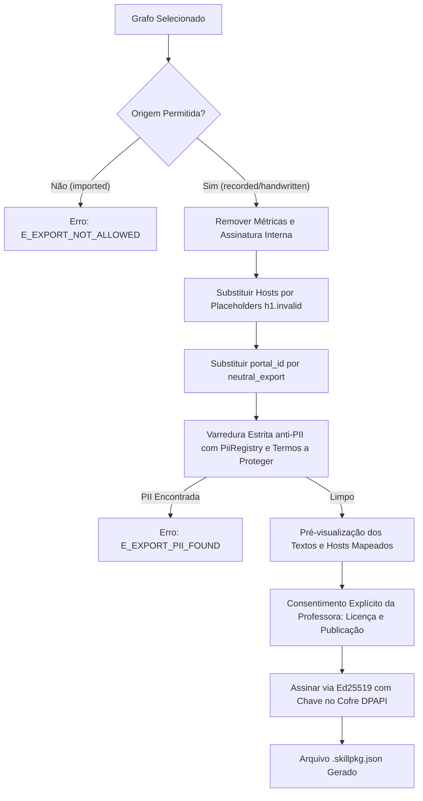

# Nota de Design da Comunidade (Fase 7: Pacotes de Mapas, Assinatura e Registro)

**Documento:** `docs/community/COMMUNITY_DESIGN.md`  
**Data:** 11 de outubro de 2026  
**Status:** Proposta de Arquitetura (GATE 0)  
**Branch:** `fase-7-comunidade`

---

## 1. Modelo de Ameaças

O compartilhamento de mapas de automação (`SkillGraph`) entre professoras introduz uma cadeia de suprimentos distribuída. O modelo de ameaças do Teacher AI opera sob a premissa de **confiança zero no publicador**: qualquer pacote pode ser malicioso, mesmo que venha assinado.

| Ameaça | Vetor de Ataque | Mitigação Técnica no App | Risco Residual / Limite Honesto |
| :--- | :--- | :--- | :--- |
| **Pacote adulterado em trânsito** | Modificação de nós, âncoras ou seletores após a assinatura. | Verificação de assinatura Ed25519 sobre canonicalização JCS (RFC 8785). Falha $\rightarrow$ `E_PKG_SIGNATURE_INVALID`. | Nulo contra modificações não assinadas. |
| **Assinatura removida ou forjada** | Pacote sem campo de assinatura ou com algoritmo inseguro. | Rejeição obrigatória (`E_PKG_UNSIGNED`). Apenas algoritmo `ed25519` aceito. | Nenhum pacote sem assinatura válida é aceito. |
| **Chave falsa / Typosquatting** | Atacante cria chave com handle falso (ex.: "prof_mariana_oficial"). | Identidade criptográfica estrita baseada no `key_id` (SHA-256 da chave pública bruta). Handle é puramente cosmético. | Professora deve conferir fingerprint visualmente ao fixar confiança. |
| **Host de exfiltração em `allowed_hosts`** | Publicador insere domínio sob seu controle (ex.: `evil-analytics.com`) para roubar cookies/dados. | **Hosts como Placeholders**: todo host no pacote vira `h1.invalid`. A importadora vincula manualmente a seu portal. Hosts não-placeholders $\rightarrow$ `E_PKG_UNBOUND_HOST`. | Erro humano se a importadora vincular um host malicioso que ela mesma digitou. |
| **Escrita sem checkpoint** | Grafo injeta nós `WRITE` diretos sem autorização da usuária. | Validador estático do contrato (`validateGraph`) rejeita com `E_WRITE_WITHOUT_CHECKPOINT`. | Zero escrita sem checkpoint prévio. |
| **Clique destrutivo não declarado** | Nó `CLICK` com `is_submit_action: false` apontando para "Excluir turma" ou "Apagar diário". | **Guarda de Cliques em Runtime**: para grafos `imported`, o driver inspeciona o alvo; se contiver verbos destrutivos/envio, aborta com `E_CLICK_UNDECLARED_SUBMIT`. | **Limite Honesto**: Heurística de acessibilidade reduz fortemente, mas não elimina ícones sem rótulo semântico. |
| **PII vazando em parâmetros / URLs** | Mapa inclui CPFs ou nomes reais em `params.default`, rotas ou âncoras. | Varredura de PII no validador (`E_PII_LITERAL`), sanitização na exportação (`scrubGraph`) e checagem regex na importação (`E_PKG_PII`). | Casos raros de dados que não casem com padrões de CPF/e-mail/telefone e não constem no registro. |
| **Regex catastrófica (ReDoS)** | Padrão regex exponencial em `text_matches` congelando a engine. | Validador estático de regex segura (`safeRegex`) rejeita quantificadores aninhados; runtime trunca texto a 2000 caracteres. | Expressões complexas limitadas por timeout de condição. |
| **Exploração de parser JSON** | Chaves duplicadas, `__proto__`, `constructor`, profundidade recursiva > 32. | `strictJsonParse` personalizado rejeita mutações de protótipo, duplicatas e profundidade antes de Zod. | Totalmente contido antes da desserialização. |
| **Ofuscação de texto (Bidi / Zero-width)** | Caracteres de inversão de direção (U+202E) ou invisíveis para mascarar comandos. | Rejeição estrita com `E_PKG_UNSAFE_TEXT` se houver caracteres de controle, zero-width ou bidi. | Texto exibido na interface é 100% legível e plano. |
| **Bomba de descompressão / Tamanho** | Pacote com centenas de megabytes exaurindo memória do app. | Teto rígido: pacote $\le$ 512 KB, grafo $\le$ 256 KB, nós $\le$ 200. Violação $\rightarrow$ `E_PKG_TOO_LARGE` / `E_LIMITS`. | Consumo de memória rigidamente previsível. |
| **Regressão de versão maliciosa** | Atacante força o app a importar versão antiga com vulnerabilidade conhecida. | Tabela `seen_versions` rastreia a maior versão por `(key_id, package_id)`. Versão menor $\rightarrow$ `E_PKG_ROLLBACK`. | Requer confirmação explícita da usuária para downgrade intencional. |
| **Chave privada comprometida** | Chave do publicador vaza e atacante assina pacotes maliciosos. | Lista de revogação no registro (`revoked_keys`). Mapas existentes voltam à quarentena (`revogado`). | Janela entre o vazamento e a publicação da revogação no índice. |
| **Índice do registro adulterado** | Man-in-the-middle altera índice para apontar para pacotes hostis. | Índice é assinado pela chave raiz do registro (`pinnedKey.ts`). Hash SHA-256 de cada pacote checado contra o índice. | Servidor estático comprometido não consegue forjar a assinatura offline. |
| **Espionagem de consulta ao registro** | Registro rastreia quais portais ou tarefas a professora busca. | **Privacidade da Consulta**: o app baixa o índice completo (até 2 MB) e a busca é 100% local. O servidor só vê download do índice. | Provedor de CDN vê apenas endereço IP baixando `index.json`. |
| **Vazamento da escola na publicação** | Professora publica mapa e acidentalmente identifica sua escola ou município. | Pipeline de exportação substitui todos os hosts por placeholders neutros (`h1.invalid`) e exige revisão de termos livres. | Textos descritivos não identificados na checagem devem ser revisados no preview. |
| **Execução indevida de mapa importado** | Extensão ou automação roda mapa importado sem homologação. | **Quarentena Imposta no Desktop**: todo mapa importado nasce `quarantined`; o serviço de auditoria recusa ack de escrita com `E_GRAPH_QUARANTINED`. | Impossível realizar mutação física no DOM sem ativação expressa no desktop. |

---

## 2. Formato do Pacote (`skillpkg/1`)

O pacote comunitário é um arquivo JSON único com extensão `.skillpkg.json` (teto de 512 KB):

```json
{
  "pkg_format": "skillpkg/1",
  "manifest": {
    "package_id": "diario-escolar-frequencia",
    "map_version": 1,
    "spec_version": "2.0",
    "publisher": {
      "key_id": "a1b2c3d4e5f60718293a4b5c6d7e8f90123456789abcdef0123456789abcdef0",
      "handle": "prof_claudia"
    },
    "license": "CC-BY-4.0",
    "platform_hint": "paineldoaluno",
    "hosts": [
      {
        "placeholder": "h1.invalid",
        "role": "portal",
        "suffix_hint": "paineldoaluno.com.br"
      },
      {
        "placeholder": "h2.invalid",
        "role": "idp"
      }
    ],
    "tasks": ["read_roster", "lancar_falta"],
    "compat": {
      "support_tier": 1,
      "archetype_tags": ["standard_table", "two_row_headers"],
      "tested_archetypes": ["standard_table"]
    },
    "min_app_version": "0.1.0",
    "created_at": "2026-10-11T20:00:00Z"
  },
  "content": {
    "spec_version": "2.0",
    "identity": { ... },
    "compat": { ... },
    "params": { ... },
    "nodes": { ... },
    "canonical_mapping": { ... },
    "safety": {
      "side_effect_level": "write",
      "writes_require_checkpoint": true,
      "max_writes_per_run": 50,
      "rate_limit": { "min_delay_ms": 200, "jitter_ms": 100 },
      "allowed_hosts": ["h1.invalid", "h2.invalid"]
    },
    "provenance": { ... }
  },
  "signature": {
    "alg": "ed25519",
    "key_id": "a1b2c3d4e5f60718293a4b5c6d7e8f90123456789abcdef0123456789abcdef0",
    "public_key": "302a300506032b6570032100...",
    "sig": "3a5f...base64..."
  }
}
```

### Regras de Estrutura e Canonicalização
1. **Canonicalização JCS (RFC 8785):** Ordenação lexicográfica recursiva de chaves Unicode UTF-16, sem espaços entre separadores (`:`, `,`), representação numérica padrão ECMAScript. Implementação pura em TypeScript em `lib/desktop-core/community/canonical.ts`.
2. **Objeto Assinado:** A assinatura Ed25519 cobre os bytes exatos de:
   $$\text{JCS}(\{\text{"pkg\_format"}: \text{"skillpkg/1"}, \text{"manifest"}: \dots, \text{"content"}: \dots\})$$
3. **Parse Estrito (`strictJsonParse`):**
   - Rejeita chaves duplicadas (ex.: `{"a": 1, "a": 2}`).
   - Rejeita chaves perigosas: `__proto__`, `constructor`, `prototype`.
   - Limita profundidade recursiva a 32 níveis.
   - Rejeita números fora do intervalo seguro `Number.isSafeInteger` ou `NaN`/`Infinity`.

---

## 3. Gestão Criptográfica de Chaves

1. **Par de Chaves Ed25519:** Gerado nativamente via `node:crypto.generateKeyPairSync('ed25519')`.
2. **Isolamento de Chaves Privadas:**
   - A chave privada do publicador é mantida **exclusivamente no cofre DPAPI do SO** (`VaultManager` no processo main do Electron).
   - A interface do usuário e a extensão recebem apenas o `key_id` e a chave pública.
3. **Identificador de Chave (`key_id`) e Fingerprint:**
   - $\text{key\_id} = \text{SHA-256}(\text{public\_key\_raw\_32\_bytes})$.
   - Fingerprint visual para a professora: exibido em grupos de 4 caracteres hexadecimais separados por espaço (ex.: `a1b2 c3d4 e5f6 0718 293a 4b5c 6d7e 8f90 ...`).
4. **Fixação de Confiança (TOFU):**
   - Nível `assinado_desconhecido`: assinatura válida, porém chave inédita.
   - Nível `assinado_confiavel`: a usuária conferiu o fingerprint e marcou a chave como confiável na tabela `trusted_keys`.
   - Nível `revisado_no_registro`: chave presente no índice oficial do repositório comunitário.
5. **Chave Raiz do Registro:**
   - Chave pública do mantenedor fixada estaticamente em código (`desktop/registry/pinnedKey.ts`).
   - Rotação de chave do registro ocorre apenas via atualização oficial do aplicativo desktop.

---

## 4. Hosts como Placeholders e Vinculação Segura

Para garantir total anonimato da escola do publicador e impedir que um mapa malicioso force acessos externos:
1. **Formato Placeholder:** Todos os hosts no grafo exportado devem obedecer ao formato `h<N>.invalid` (ex.: `h1.invalid`, `h2.invalid`), domínio reservado por RFC 2606 / RFC 6761 que nunca resolve em DNS.
2. **Campos com Mapeamento Obrigatório:**
   - `safety.allowed_hosts`
   - `identity.domain`
   - `NAVIGATE.host`
   - `Fingerprint.route.host`
   - `FrameRef.url_pattern` (substituição do domínio)
   - `Condition` com `url_matches`
3. **Vinculação na Importação (`bindHosts`):**
   - Papel `portal`: o host real fornecido pela professora deve casar com o `suffix_hint` do manifesto (se presente) ou com o domínio já vinculado ao portal dela. Caso divirja, rejeita com `E_BIND_SUFFIX_MISMATCH`.
   - Papel `idp` (Provedor de Identidade): aceita apenas domínios de uma lista restrita embutida (`desktop-core/community/knownIdps.ts`, ex.: `login.microsoftonline.com`, `accounts.google.com`, `gov.br`) ou dupla confirmação explícita.
   - Papel `other`: requer confirmação consciente dos efeitos.
   - Se o pacote contiver qualquer host real ou formato fora de `h<N>.invalid` antes da vinculação: rejeição imediata com `E_PKG_UNBOUND_HOST`.

---

## 5. Pipeline de Exportação de Mapas



1. **Seleção:** Somente grafos com `provenance.source` igual a `recorded` ou `handwritten` são exportáveis.
2. **Termos a Proteger:** Além dos dados do banco, a tela permite que a professora insira termos customizados (nome da instituição, nomes próprios de coordenadores) para garantia de expurgo.
3. **Licenças Permitidas:** Enum fechado (`CC0-1.0` ou `CC-BY-4.0`).

---

## 6. Pipeline de Importação em Estágios

Cada estágio é obrigatório e determinístico. Nenhuma etapa é opcional:

1. **Estágio 1 — Parse Estrito:** `strictJsonParse(rawText)`. Erro $\rightarrow$ `E_PKG_UNSAFE_JSON`.
2. **Estágio 2 — Limites Físicos:** Tamanho total $\le$ 512 KB, profundidade $\le$ 32. Erro $\rightarrow$ `E_PKG_TOO_LARGE`.
3. **Estágio 3 — Formato e Versão:** Validação do manifesto via `PackageSchema.strict()`. Erro $\rightarrow$ `E_PKG_SPEC_UNSUPPORTED`.
4. **Estágio 4 — Assinatura Criptográfica:** Verificação de Ed25519 sobre canonicalização JCS. Erro $\rightarrow$ `E_PKG_SIGNATURE_INVALID` ou `E_PKG_KEY_MISMATCH`.
5. **Estágio 5 — Lista de Revogação:** Verifica se `publisher.key_id` consta na tabela de chaves revogadas. Erro $\rightarrow$ `E_PKG_KEY_REVOKED`.
6. **Estágio 6 — Validação do Grafo:** Executa Zod estrito e `validateGraph(content)`. Erro $\rightarrow$ `E_PKG_GRAPH_INVALID`.
7. **Estágio 7 — Higiene de Textos:** Varredura de caracteres de controle, bidi e zero-width. Erro $\rightarrow$ `E_PKG_UNSAFE_TEXT`.
8. **Estágio 8 — Higiene de Regex:** Verificação de ReDoS em todas as expressões de `text_matches`. Erro $\rightarrow$ `E_PKG_UNSAFE_REGEX`.
9. **Estágio 9 — Ausência de Hosts Reais:** Confirma que todos os campos de host contêm estritamente `*.invalid`. Erro $\rightarrow$ `E_PKG_UNBOUND_HOST`.
10. **Estágio 10 — Varredura Residual de PII:** Checa padrões de CPF, e-mail e telefone no conteúdo. Erro $\rightarrow$ `E_PKG_PII`.
11. **Estágio 11 — Proteção contra Regressão de Versão:** Checa `map_version` contra `seen_versions`. Erro $\rightarrow$ `E_PKG_ROLLBACK`.
12. **Estágio 12 — Geração de Relatório de Efeitos:** Lista todos os nós arriscados, ações de escrita e hosts a vincular.
13. **Estágio 13 — Entrada em Quarentena:** Salva pacote original e derivação no banco com `is_quarantined = 1`.

---

## 7. Derivação Local do Grafo (`deriveLocalGraph`)

O pacote original `.skillpkg.json` é armazenado intacto na tabela `imported_packages`. A versão executável gerada por `deriveLocalGraph` **só pode diferir nos seguintes campos autorizados**:

1. **Hosts:** Substituição dos placeholders `h<N>.invalid` pelos hosts reais vinculados.
2. **Identidade do Portal:** `identity.portal_id` recebe o identificador do portal da usuária local.
3. **Versão:** `identity.version` recebe $\max(\text{versão local}) + 1$.
4. **Proveniência:** `provenance.source` fixado como `'imported'`.
5. **Endurecimento de Segurança (`safety`):**
   - `max_writes_per_run`: mantido ou reduzido (nunca aumentado).
   - `rate_limit.min_delay_ms`: mantido ou aumentado (nunca reduzido).

Qualquer alteração em nós, arestas, seletores, parâmetros ou checkpoints faz o teste de equivalência falhar com erro de integridade.

---

## 8. Quarentena e Condições de Ativação

A quarentena é imposta pelo app desktop e garantida em banco:

1. **Enforcement no Desktop:**
   - `graphs.resolveActive` (busca de versão ativa) filtra `is_quarantined = 0`.
   - `SqlAuditRepository.append`: ao receber entrada de auditoria com `action: 'write'`, verifica se o grafo está em quarentena; se estiver, rejeita a auditoria com `E_GRAPH_QUARANTINED`.
   - Como o runner exige ack antes de qualquer `WRITE`, nenhuma gravação ocorre mesmo sob simulação ou falha na extensão.
2. **Requisitos Obrigatórios para Ativação:**
   - Visualização e confirmação do **Relatório de Efeitos**.
   - Execução bem-sucedida de um **Dry-Run (Simulação sem Escrita)** no portal local da professora.
   - Para publicadores com nível `assinado_desconhecido`: consentimento explícito e consciente adicional.
   - Nenhuma caixa de seleção pode vir pré-marcada.

---

## 9. Guardas de Runtime para Grafos Importados

Para minimizar riscos de comportamento malicioso sorrateiro em portais reais:

1. **Guarda de Cliques:**
   - Antes de executar qualquer `CLICK` com `is_submit_action: false` em grafo `imported`, o runner consulta `driver.describeClickTarget(target)`.
   - Se o alvo tiver atributo `type="submit"`, estiver dentro de `<form>` como botão principal ou possuir nome acessível contendo verbos da lista de envio/destruição (`salvar`, `gravar`, `confirmar`, `enviar`, `concluir`, `excluir`, `apagar`, `remover`, `deletar`, `cancelar`, `encerrar`, e equivalentes em inglês), o runner aborta imediatamente com `E_CLICK_UNDECLARED_SUBMIT`.
2. **Guarda de Expressões Regulares:**
   - Textos inspecionados por `text_matches` são truncados em no máximo 2000 caracteres antes da avaliação da regex, eliminando janelas de DoS em textos gigantes.
3. **Imutabilidade de Comportamento:**
   - Grafos `recorded` ou `handwritten` não são submetidos à guarda de cliques heurística, preservando 100% da compatibilidade anterior.

---

## 10. Registro Comunitário sem Servidor Próprio

O registro utiliza distribuição estática descentralizada sobre repositório Git público:

```text
registry-template/
├── index.json                  # Índice assinado com metadados de todos os pacotes
├── packages/
│   └── <package_id>/
│       └── <map_version>.skillpkg.json
├── README.md
├── CONTRIBUTING.md
└── .github/workflows/
    └── validate.yml            # CI de validação em Pull Requests
```

1. **Schema do Índice (`index.json`):**
   - Contém `packages`: lista de pacotes com `package_id`, `map_version`, `publisher_key_id`, `sha256`, `size`, `tasks`, `reviewed`.
   - Contém `revoked_keys` (chaves comprometidas) e `revoked_packages` (versões específicas bloqueadas).
   - Assinatura Ed25519 raiz do mantenedor sobre o índice canônico JCS.
2. **Privacidade Absoluta da Consulta:**
   - O app desktop faz download exclusivo do arquivo completo `index.json` (teto de 2 MB).
   - Toda busca por palavras-chave, portais e tarefas ocorre **localmente em memória**.
   - O servidor ou CDN jamais recebe telemetria sobre o que a professora pesquisou.
3. **Restrições de Rede no Processo Main:**
   - Chamadas HTTP executadas exclusivamente em `desktop/registry/client.ts` via HTTPS.
   - Proibido seguir redirecionamentos entre domínios distintos.
   - Zero envio de cookies, tokens locais ou cabeçalhos identificadores.
   - Timeout rígido de 10 segundos.

---

## 11. Política do Registro Comunitário (Rascunho a Validar)

1. **Licenciamento:** Todo mapa submetido deve ser licenciado sob termos permissivos abertos (`CC0-1.0` ou `CC-BY-4.0`).
2. **LGPD e Dados Pessoais:** Proibição irrestrita de qualquer dado pessoal, nomes de escolas reais em textos de descrição ou credenciais embutidas. Violação resulta em recusa sumária na CI.
3. **Portais que Vedam Automação:** Mapas destinados a sistemas com termos explícitos contrários a automações serão rejeitados ou sinalizados com aviso destacado.
4. **Procedimento de Takedown:** Procedimento transparente de desativação e revogação imediata via inclusão da chave ou pacote na lista de revogações do índice.
5. **Isenção de Garantia:** O repositório é provido "como está". O selo `reviewed: true` atesta que a lista de checagem técnica foi cumprida pelo mantenedor, sem garantia de imunidade contra alterações de portais terceiros.

---

## 12. Esquema do Banco de Dados (Migração `002`)

```sql
-- ── Migração 002: Tabelas da Comunidade ─────────────────────────────────────

CREATE TABLE IF NOT EXISTS publisher_keys (
  key_id TEXT PRIMARY KEY,
  handle TEXT NOT NULL,
  public_key TEXT NOT NULL,
  created_at TEXT NOT NULL
);

CREATE TABLE IF NOT EXISTS trusted_keys (
  key_id TEXT PRIMARY KEY,
  handle TEXT,
  pinned_at TEXT NOT NULL,
  trusted_by_user INTEGER DEFAULT 1
);

CREATE TABLE IF NOT EXISTS imported_packages (
  package_id TEXT NOT NULL,
  map_version INTEGER NOT NULL,
  publisher_key_id TEXT NOT NULL,
  package_json TEXT NOT NULL,
  raw_sha256 TEXT NOT NULL,
  is_quarantined INTEGER DEFAULT 1,
  trust_level TEXT NOT NULL,
  bound_portal_id TEXT NOT NULL,
  bound_version INTEGER NOT NULL,
  imported_at TEXT NOT NULL,
  PRIMARY KEY (package_id, map_version)
);
CREATE INDEX IF NOT EXISTS idx_imported_binding ON imported_packages(bound_portal_id, bound_version);

CREATE TABLE IF NOT EXISTS seen_versions (
  publisher_key_id TEXT NOT NULL,
  package_id TEXT NOT NULL,
  max_seen_version INTEGER NOT NULL,
  updated_at TEXT NOT NULL,
  PRIMARY KEY (publisher_key_id, package_id)
);

CREATE TABLE IF NOT EXISTS registry_cache (
  id TEXT PRIMARY KEY DEFAULT 'primary',
  index_json TEXT NOT NULL,
  fetched_at TEXT NOT NULL,
  signature_verified INTEGER NOT NULL
);
```

---

## 13. Métodos IPC (Exclusivos para a UI)

| Método IPC | Descrição | Validação Zod |
| :--- | :--- | :--- |
| `community.exportPackage` | Exporta e assina um grafo local para `.skillpkg.json`. | `ExportPackageParamsSchema.strict()` |
| `community.inspectPackage` | Realiza os primeiros 10 estágios e gera o relatório de efeitos. | `InspectPackageParamsSchema.strict()` |
| `community.importPackage` | Vincula hosts, deriva grafo e salva em quarentena. | `ImportPackageParamsSchema.strict()` |
| `community.activate` | Ativa mapa após conferência de efeitos e prova de dry-run. | `ActivatePackageParamsSchema.strict()` |
| `community.listKeys` | Lista chaves confiáveis e fixadas. | `ListKeysParamsSchema.strict()` |
| `community.pinKey` | Fixa confiança de uma chave pública conferida. | `PinKeyParamsSchema.strict()` |
| `registry.fetchIndex` | Baixa o índice assinado via HTTPS (ação manual da usuária). | `FetchIndexParamsSchema.strict()` |
| `registry.search` | Realiza busca local em memória no índice cacheado. | `SearchRegistryParamsSchema.strict()` |

---

## 14. Suíte Adversarial de Conformidade

A suíte de testes de conformidade valida de forma independente a robustez do pipeline.

### Casos de Desenvolvimento (DEV: 12 casos — 4 Legítimos, 8 Hostis)
- **Legítimos (4):** Pacote canônico `read_roster`, pacote canônico `lancar_falta`, pacote com host de autenticação `idp`, atualização válida de versão (`v1` $\rightarrow$ `v2`).
- **Hostis (8):** Pacote sem assinatura (`E_PKG_UNSIGNED`), assinatura corrompida por 1 byte (`E_PKG_SIGNATURE_INVALID`), pacote com host real em vez de placeholder (`E_PKG_UNBOUND_HOST`), chave do manifesto divergente da assinatura (`E_PKG_KEY_MISMATCH`), pacote acima de 512 KB (`E_PKG_TOO_LARGE`), texto com caractere de controle (`E_PKG_UNSAFE_TEXT`), regex com quantificador aninhado ReDoS (`E_PKG_UNSAFE_REGEX`), downgrade de versão sem permissão (`E_PKG_ROLLBACK`).

### Casos de Holdout (HOLDOUT: 20 casos — 6 Legítimos, 14 Hostis)
- **Legítimos (6):** Um por cada tarefa canônica (5) + um com dois hosts vinculados (`portal` e `idp`).
- **Hostis (14):** Modificação de nó após assinatura; remoção do nó `CHECKPOINT` mantendo `WRITE`; chave pública revogada no índice; hash do arquivo divergente do índice; índice com assinatura corrompida; chave duplicada em JSON com protótipo poluído; placeholder vinculado a host divergente do `suffix_hint`; literal no formato de CPF nos nós; literal no formato de e-mail; nós excedendo limite de 200; `spec_version` diferente de 2.0; nó com referência pendente; ciclo artificial no fluxo de execução; tentativa de escrita com ack em quarentena.

**Metas Rígidas:** Hostis aceitos = **0**; Legítimos aceitos $\ge 85\%$; Lock íntegro (`conformance/community/holdout.lock`).

---

## 15. Novos Códigos de Erro e Mensagens Amigáveis

| Código de Erro | Mensagem Técnica | Tradução Acolhedora para a Professora |
| :--- | :--- | :--- |
| `E_PKG_UNSIGNED` | O pacote não contém assinatura digital válida. | *"Este pacote de mapa não foi assinado digitalmente e não pode ser aberto com segurança."* |
| `E_PKG_SIGNATURE_INVALID` | A assinatura criptográfica Ed25519 é inválida para o conteúdo. | *"Este mapa parece ter sido alterado após a publicação. A assinatura não confere."* |
| `E_PKG_KEY_MISMATCH` | A chave pública do manifesto difere da chave que assinou o pacote. | *"Identificação da autora divergente da assinatura do arquivo."* |
| `E_PKG_KEY_REVOKED` | A chave da autora foi revogada no registro comunitário. | *"A chave desta autora foi desativada por segurança no registro da comunidade."* |
| `E_PKG_HASH_MISMATCH` | O hash SHA-256 do arquivo difere da entrada no índice do registro. | *"O arquivo baixado não confere com o registro oficial da comunidade."* |
| `E_PKG_TOO_LARGE` | O pacote excede o tamanho máximo permitido de 512 KB. | *"O arquivo do mapa é muito grande e ultrapassa os limites seguros de tamanho."* |
| `E_PKG_UNSAFE_JSON` | JSON malformado, chaves duplicadas ou poluição de protótipo. | *"O formato interno do arquivo contém anomalias e foi recusado por proteção."* |
| `E_PKG_UNSAFE_TEXT` | Texto com caracteres invisíveis, de controle ou de inversão bidi. | *"O mapa contém textos com caracteres especiais não permitidos."* |
| `E_PKG_UNSAFE_REGEX` | Padrão de expressão regular inseguro suscetível a travamento. | *"Uma das regras de busca do mapa é muito complexa e poderia travar seu navegador."* |
| `E_PKG_SPEC_UNSUPPORTED` | Versão de especificação de mapa incompatível com este app. | *"Este mapa foi criado para outra versão do aplicativo. Atualize seu app."* |
| `E_PKG_GRAPH_INVALID` | O grafo interno falhou nas regras de validação estática. | *"A estrutura interna do mapa contém erros e não pode ser executada."* |
| `E_PKG_PII` | Dados pessoais sensíveis detectados no mapa. | *"Detectamos possíveis dados pessoais no mapa. O arquivo foi bloqueado para proteger a privacidade."* |
| `E_PKG_UNBOUND_HOST` | O pacote contém hosts reais em vez de marcadores neutros. | *"O mapa tenta acessar endereços diretos sem passar pela sua autorização."* |
| `E_PKG_HOST_UNMAPPABLE` | Um dos marcadores de endereço não pôde ser vinculado ao seu portal. | *"Não foi possível conectar os endereços do mapa ao seu portal escolar."* |
| `E_PKG_ROLLBACK` | Tentativa de importar versão anterior a uma já instalada. | *"Você já possui uma versão mais recente deste mapa instalada no seu computador."* |
| `E_BIND_SUFFIX_MISMATCH` | O endereço do seu portal não confere com a plataforma indicada. | *"O endereço informado parece ser diferente do tipo de portal esperado por este mapa."* |
| `E_REGISTRY_INDEX_INVALID` | Assinatura ou formato do índice comunitário inválido. | *"Não foi possível verificar a autenticidade da lista da comunidade."* |
| `E_REGISTRY_NOT_CONFIGURED` | Chave raiz do registro comunitário ainda não configurada no app. | *"O registro comunitário de mapas ainda não está ativo nesta versão do app."* |
| `E_REGISTRY_NETWORK` | Falha de comunicação HTTPS ao baixar a lista de mapas. | *"Não foi possível conectar à lista comunitária. Verifique sua conexão com a internet."* |
| `E_GRAPH_QUARANTINED` | Tentativa de executar gravação com versão ainda em quarentena. | *"Este mapa está em quarentena de segurança. Realize um teste antes de ativá-lo."* |
| `E_CLICK_UNDECLARED_SUBMIT` | Botão de ação destrutiva ou de envio acionado sem declaração. | *"Ação interrompida: o mapa tentou acionar um botão de salvar ou excluir sem permissão."* |
| `E_EXPORT_NOT_ALLOWED` | Mapas importados de outras pessoas não podem ser reexportados. | *"Apenas mapas gravados por você neste computador podem ser compartilhados."* |
| `E_EXPORT_PII_FOUND` | Dados pessoais da sua escola foram encontrados ao exportar. | *"Encontramos informações da sua turma ao preparar o mapa. A exportação foi cancelada por segurança."* |

---

## 16. Bloqueio de Contrato

- **Vazio.**
- A validação de `safety.allowed_hosts` em `lib/contracts/skillgraph/validate.ts:205` apenas compara pertinência com `NAVIGATE.host`. Nenhum validador rejeita TLDs reservados como `.invalid` ou nomes sintéticos como `h1.invalid`. Os contratos congelados v2.0 permanecem 100% intocados.

---

## 17. Layout de Pastas e Arquivos da Fase 7

```text
lib/desktop-core/community/
├── strictJson.ts               # Parser seguro anti-poluição de protótipo
├── canonical.ts                # Canonicalização JCS RFC 8785 pura em TS
├── packageSchema.ts            # Schemas Zod .strict() do pacote e manifesto
├── signing.ts                  # Ed25519, hashing SHA-256 e fingerprints
├── errors.ts                   # Códigos e classes de erro comunitários
├── limits.ts                   # Constantes de limites (512 KB, 256 KB, 32 níveis)
├── unsafeText.ts               # Verificação de caracteres bidi/controle/zero-width
├── safeRegex.ts                # Validação estática anti-ReDoS
├── knownIdps.ts                # Lista de domínios confiáveis para login
├── export/
│   ├── hostMap.ts              # Reescreve hosts reais para h1.invalid
│   ├── sanitize.ts             # Expurgador anti-PII com termos a proteger
│   ├── exportPreview.ts        # Resumo legível para confirmação da professora
│   └── buildPackage.ts         # Montagem e assinatura do skillpkg
├── import/
│   ├── pipeline.ts             # Execução dos 13 estágios estritos
│   ├── bindHosts.ts            # Associação de placeholders a hosts reais
│   ├── deriveLocalGraph.ts     # Derivação do grafo local com diferenças permitidas
│   ├── effectsReport.ts        # Relatório detalhado de nós arriscados
│   ├── trust.ts                # Classificação de confiança de publicadores
│   ├── rollback.ts             # Verificação contra regressão de versões
│   └── quarantine.ts           # Gestão de estados de quarentena
└── registry/
    ├── indexSchema.ts          # Schema do índice comunitário
    ├── verifyIndex.ts          # Verificação da assinatura do índice e hashes
    ├── search.ts               # Busca local em memória
    └── trustResolve.ts         # Cruzamento com chaves revogadas

desktop/registry/
├── client.ts                   # Cliente HTTPS seguro (sem cookies/rastreio)
└── pinnedKey.ts                # Chave pública offline raiz do registro

conformance/community/
├── testKeys.ts                 # Chaves de teste derivadas de sementes TEST_ONLY
├── holdout.lock                # Checksums travados do HOLDOUT
└── recipes/                    # Receitas JSON declarativas (DEV e HOLDOUT)
```

---

## 18. Perguntas ao Dono (GATE 0)

1. **Hospedagem do Registro:**  
   Recomendamos repositório Git estático (ex.: GitHub Pages ou CDN simples de arquivos) com consulta 100% estática via download de `index.json`, garantindo zero custo de infraestrutura e zero telemetria. **Aprova esta abordagem?**
2. **Licença Padrão dos Mapas:**  
   Recomendamos `CC-BY-4.0` (atribuição amigável à professora que gravou) com opção alternativa `CC0-1.0` (domínio público). **Aprova estas duas opções?**
3. **Hosts como Placeholders (`h1.invalid`):**  
   Confirmamos a regra de que nenhum mapa exportado conterá o endereço web real da escola, exigindo que a professora importadora aponte seu próprio portal no ato da importação. **Aprova este atrito consciente de segurança?**
4. **Lançamento Inicial do Registro:**  
   Recomendamos iniciar em **Beta Fechado** (a chave pública do registro em `pinnedKey.ts` vazia por padrão até sua configuração expressa), permitindo testes controlados antes da abertura pública. **Aprova o Beta Fechado?**
5. **Revisão de Pacotes e Custódia da Chave:**  
   A chave privada de assinatura do registro deve ser mantida offline exclusivamente por você (nunca no repositório), e as contribuições submetidas via Pull Request no Git. **Confirma esta política operacional?**
6. **Verificação Automática de Atualizações:**  
   Recomendamos manter a busca de mapas e atualizações **100% manual por clique de botão da usuária** (desligada em background por padrão), preservando total silêncio de rede. **Aprova esta postura estrita?**
7. **Identificação do Publicador:**  
   O identificador público exibido é o `handle` (pseudônimo escolar ou apelido), enquanto a identidade criptográfica é o `key_id`. **Aprova o uso de handles pseudônimos?**
8. **Portais com Cláusulas Contrárias a Automação:**  
   Caso surjam portais com termos de uso que desautorizem automação assistida, recomendamos recusar a publicação no índice oficial com mensagem orientativa transparente. **Aprova este critério editorial?**
